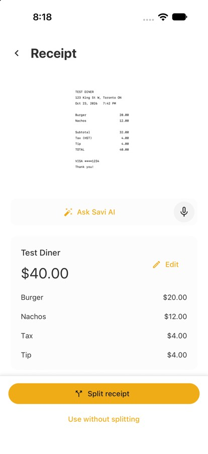

# Savi Finance — Group Split with Voice

> D4 project handoff. Implementation status is listed below; feature availability depends on the app build, backend and feature flags.

## Project

We are extending Savi Finance so people can split shared expenses, understand their own spending, and review who owes whom without maintaining a separate spreadsheet. Our team's work covers one-off splits, receipt/item splitting with voice or typed assignment, group transaction splits, and a balances overview.

**Implementation repository:** [Savi Finance's private monorepo](https://github.com/cheapreats/ce). Teaching staff need access to this repository to inspect the linked implementation PRs and evidence. The features described below are our team's contributions, not a description of the entire Savi product.

## Implementation Status (D4)

PR status checked on **November 27, 2026** in Savi's implementation repository:

- **Group and receipt splitting:** [#6761](https://github.com/cheapreats/ce/pull/6761) merged into `main` at commit [`b7f4d45aed`](https://github.com/cheapreats/ce/commit/b7f4d45aed91d4b218377b6f6fe645bd7f0dae07). The original receipt [#6759](https://github.com/cheapreats/ce/pull/6759) and group-transaction [#6760](https://github.com/cheapreats/ce/pull/6760) PRs are closed; their work was combined in #6761.
- **One-off split backend:** [#6605](https://github.com/cheapreats/ce/pull/6605), [#6606](https://github.com/cheapreats/ce/pull/6606), [#6607](https://github.com/cheapreats/ce/pull/6607), [#6608](https://github.com/cheapreats/ce/pull/6608) and [#6609](https://github.com/cheapreats/ce/pull/6609) merged into `main`.
- **One-off split mobile flow:** [#6768](https://github.com/cheapreats/ce/pull/6768) remains open against `main` and includes the former editor PR [#6624](https://github.com/cheapreats/ce/pull/6624), which is closed. Own-share spending [#6769](https://github.com/cheapreats/ce/pull/6769) merged into the #6768 branch, not `main`. Guest invitations and participant emails [#7452](https://github.com/cheapreats/ce/pull/7452) remain open against that same branch.
- **Owed/owing widget:** [#6770](https://github.com/cheapreats/ce/pull/6770) remains open against `main` and is gated by `mobile_split_balances`.

These are implementation/review statuses, not confirmation that a feature is available in Savi's released app. Current source links below use `main`; removed documents/components are explicitly linked as historical references.

**Partner-controlled deployment:** Our project extends Savi Finance's existing mobile app rather than introducing a separate application to host. Savi controls its private repository, hosted backend, app builds and public releases. For course review, we provide implementation PRs, local setup instructions, screenshots and demo recordings. We discussed this approach with our tutorial TA, Rayan, who approved using the linked development work and demo evidence to account for the partner-controlled release process.

## D3 Improvement and Walkthrough Video

**What changed since D2:** After D2, a receipt split could be built but not saved, so it never became a real group expense. In D3, receipt splitting saves through the shared group-expense flow: one person scans a receipt, assigns items to group members (by tapping, or by typing a sentence), and saves it; the other person then sees what they owe on their own account and in the group's history.

**What changed since D2 (one-off splits):** After D2, the one-off editor was a read-only preview, and saving and own-share spending were still drafts. In D3, a one-off split can be saved, reopened, edited and removed. Spending counts only your share while Wallet keeps the full payment, and failed creates and deletes can now be retried safely. For current merge status, see [Implementation Status](#implementation-status-d4); the recordings below show the D3 development state.

**Walkthrough video (3:30):** [Receipt split, end to end](https://drive.google.com/file/d/1_RcoIVwYVeFO3oh8SeUBXMU0YUKbhP6R/view?usp=sharing). Recorded on the iOS Simulator against a local Savi backend running the integration branch ([#6761](https://github.com/cheapreats/ce/pull/6761)), with two test accounts. Alex scans a receipt (Burger $20, Nachos $12, tax $4, tip $4), assigns items by typing *"Sarah had the burger, we shared the nachos"*, and saves; Sarah then sees that she owes $32.50. The scan step waits about 15 seconds for the AI response.

**Walkthrough video (2:17):** [One-off split, Wallet and Spending](https://drive.google.com/file/d/1KaMqoWcxLLfajq9Pm_DCc2pHlZnHNevy/view?usp=sharing). Recorded on the iOS Simulator against a local Savi backend running the one-off stack. A $42 expense is split $12 / $30 and saved: Wallet shows the full −$42 payment, and Spending shows the payer's $12 share. A short [Android recording (0:08)](https://drive.google.com/file/d/145_8mzCBMKQLj8w-mCyeg4eo_Anwdo8s/view?usp=sharing) shows the same result, and screenshots are in [#6769](https://github.com/cheapreats/ce/pull/6769).

**Screenshots (D3):** D2 "before" screenshots are in the description of [#6759](https://github.com/cheapreats/ce/pull/6759).

| Receipt read by Savi's AI | Items assigned from a typed sentence | Sarah sees she owes $32.50 | Sarah's group history |
|---|---|---|---|
|  |  |  |  |

## Key Use Cases

### Splitting a one-off expense (David, Shaun)

**Why:** split a shared purchase without creating a group, and track your own spending separately from the full payment.

**What it does** (development flow in #6768, with own-share spending from #6769):

- Splits a personal expense with eligible Savi users or saved guests using equal shares, amounts or percentages. People search is limited to people connected through a shared household, group or organization.
- Validates allocations in exact cents. Amount mode offers an explicit adjustment to your share for differences of up to $1; larger differences must be corrected.
- Saves the split with the transaction; **Manage split** lets the payer change or remove it later.
- Counts the payer's share in Spending and budget alerts while Wallet keeps the full payment: a $120 expense split equally between two people contributes $60 to the payer's spending.

**How to try it** (use the #6768 development branch and compatible backend, with identity-based split saving enabled):

1. Tap **Add transaction → Expense**, enter the name, amount and date, and choose an account owned by your personal profile.
2. Tap **Split → Total with Others**. Under **Add people**, search for and select another eligible person or saved guest.
3. Choose **Equal**, **Amount** or **Percentage**. In amount/percentage mode, tap a person's share to edit it; review the resulting allocations.
4. Tap **Apply**, then **Create** to save the transaction. Applying alone only updates the draft.
5. Reopen the transaction through **Edit → Manage split** to change the split. Removing the other participants exposes **Remove split**; save the transaction to confirm the removal.
6. Compare **Wallet** with **Insights → Spending** to see the full payment versus your share. This requires the own-share spending changes included in the #6768 branch through #6769.

**Guest invitation extension (#7452):** On that PR's branch, the payer can create a guest and use **Share invite** with an email address. The recipient opens the link, signs in with the matching verified email and claims their shares. Sharing uses the native share sheet; it does not itself send an invitation email. Separate participant notification emails are default-off. This extension is still under review and is not part of the merged backend alone.

**Development status:** The mobile editor and saving work are combined in open PR [#6768](https://github.com/cheapreats/ce/pull/6768); own-share spending [#6769](https://github.com/cheapreats/ce/pull/6769) has merged into that branch. The flow remains development-gated. Guest invitations and participant emails are separate work in open PR [#7452](https://github.com/cheapreats/ce/pull/7452). See those PRs for current checks and verification limits; these changes do not transfer money.

**Screenshots, video and implementation:** [Editor and saving #6768](https://github.com/cheapreats/ce/pull/6768), [own-share spending #6769](https://github.com/cheapreats/ce/pull/6769), [guest invitations and participant emails #7452](https://github.com/cheapreats/ce/pull/7452). The closed [editor preview #6624](https://github.com/cheapreats/ce/pull/6624) is historical evidence.

### Splitting a receipt by item (Praneeth, Shahmeer)

**Why:** People order different things and share some items. Receipt splitting lets the payer capture the bill, correct the extracted details and assign each item without re-entering the expense in a separate app.

**What it does:**

- Starts from **Add transaction → receipt/camera button**. Capture or upload a receipt, then review its image and extracted details; manual entry is also available.
- Lets the user correct the receipt title, item names, unit prices, quantities, tax and tip before saving. Discounts and tax-inclusive prices are available through the receipt options menu. The editor calculates the total from the corrected values and retains the scanned total for comparison.
- Offers **Ask Savi**, **Assign by voice** when enabled, **Split equally**, and **Assign items manually** from the receipt's split-options sheet. Ask Savi opens Savi's existing chat with receipt context; it does not confirm or save the split. **Don't split** returns the full amount to the transaction draft.
- Shows joined groups with at least two accepted members, then lets the payer choose who participated in this expense. Pending invitees cannot participate.
- Assigns items by tapping people, typing instructions or supplying a voice transcript. Shared items divide evenly; tax and tip follow each person's item subtotal. Integer-cent allocation keeps the shares equal to the confirmed total.
- Reviews each person's share before returning it to the transaction. **Create** saves the payment, receipt details and group debts, which appear in group History and Summary.

**How to try it** (use a development app and local backend containing merged PR #6761):

1. Have a group with the payer and at least one accepted member. If necessary, enable `group_card` under **Diagnostics → Feature Flags**, create a group from **Overview → Groups**, and invite the other user through group settings → **Invite member**. They accept through **Notifications → Join**.
2. From **Overview**, tap **Add transaction → Expense**, then the receipt/camera button. Take a photo or select one from Photos. Alternatively, use **Enter manually** in the receipt flow.
3. Review the receipt. Use **Edit receipt** to correct line items, quantities, tax or tip; use **Preview** to return to the receipt summary. Tap the receipt title to rename it if needed.
4. Tap **Split receipt → Assign items manually**, choose the group, select the participants on **Who's splitting?**, then tap **Continue**.
5. On **Split items**, tap the people who share each item. **Everyone** shares that item with all selected people; **Split equally** assigns every item to everyone. Alternatively, open **Assign by text**, enter a sentence such as "I had the burger, Alex had the pasta, we shared the nachos and drinks", and tap **Apply**. Check the assignments before continuing.
6. Tap **Review split**, check the total and individual shares, then **Use split in transaction**. This returns to the transaction draft; it has not saved yet.
7. Confirm the transaction name, currency and payer-owned funding account, then tap **Create**. Open the group's **History** for the saved receipt and individual debts, or **Summary** for outstanding balances.

**Verified D4 example:** Live photo-library upload and OpenRouter extraction were exercised in the iOS simulator with a synthetic four-item receipt: Burger $18, Pasta $16, Nachos $12 and Drinks $8, plus $7.02 tax and $8.10 tip, totaling **$69.12**. Assigning the burger to the payer, pasta to the other person and sharing nachos/drinks produces **$35.84** for the payer and **$33.28** owed by the other person. The saved receipt and debt were verified in group History. This is local test data, not a real purchase or a production-release verification.

**Limits and recovery:**

- Live extraction requires a valid backend OpenRouter key and provider access. The configured route is `openai/gpt-6-luna` through `azure/us`. A failed scan can be retried or continued through manual entry; OCR output must still be checked. The synthetic demo does not establish accuracy across all real receipt photos or verify physical camera capture.
- Voice assignment requires the mobile voice feature to be enabled and microphone/speech access. Real-device microphone behavior remains unverified. Typed assignment uses the on-device parser and needs no live model call; unmatched instructions require correction. Ask Savi is a separate online service.
- Empty or invalid items and incomplete assignments prevent split confirmation. Uncertain OCR values can be corrected before saving; choosing another group does not save an expense.
- Completed receipt item/assignment editing after save, automatic group budget-share attribution and post-save receipt notifications are not claimed as complete. The steps above cover creating a receipt expense, not every existing-transaction attachment/edit path. Recording debts does not transfer money.

**Implementation and evidence:** [Merged group/receipt integration #6761](https://github.com/cheapreats/ce/pull/6761). The [D3 walkthrough](https://drive.google.com/file/d/1_RcoIVwYVeFO3oh8SeUBXMU0YUKbhP6R/view?usp=sharing) and [original receipt PR #6759](https://github.com/cheapreats/ce/pull/6759) retain earlier development evidence; their screen layouts predate the current flow.

### Splitting a transaction with a group (Sumedh, Pranay)

**Why:** when one person pays for a shared expense, the app has to remember who owes what, or the split disappears as soon as the screen closes. Saving each person's share on the server is what lets Savi show balances and history, and keeps two people (or two devices) from overwriting each other's edits.

**What it does:**

* Creating a group expense saves a debt record for each non-payer participant with a positive amount owed. The payer's own share is what is left of the total (a $12 expense shared by the payer and one member saves a single $6 debt, and no debt to oneself), and shares can add up to less than the total but never more.
* Sending the same create request twice, such as a retry after an uncertain submission, returns the existing expense instead of creating a duplicate.
* The caller must have an editing role in the group, and each participant must be an accepted member. Only the payer needs a funding account; if another participant's account is supplied, its ownership is checked.
* Deleting an expense also deletes its shares, and editing the total can't go below what is already assigned to people.
* Getting or listing group expenses returns who owes what, which is what the History and Summary screens read.
* Each expense has a version number. An edit or delete can send the version it last saw, and if someone changed the expense in the meantime, it is refused with "changed by someone else" and nothing is overwritten.

**How to try it** (development app and backend containing merged PR #6761, with `group_card` enabled):

1. Create a group from the Groups section and invite a friend. They accept it from the bell icon (Notifications → Join). Only the payer needs a funding account; the friend can participate without linking a bank account.
2. Open the group and tap New Transaction.
3. Enter the description and total, choose your payer-owned funding account, and select the accepted members who shared the expense. The account determines the currency.
4. Choose **Even**, **Amounts** or **Percentages**, enter any custom shares, and check the expense preview.
5. Tap **Create**. Open **History** to see the saved expense and individual debts, or **Summary** for outstanding balances. These are saved on the server and remain after reopening the app.
6. Once a person has repaid you outside Savi, the payer can use **Mark [person] settled** in Summary and confirm it. This records settlement of that person's full share; it does not send money.

**Limits:** Full-share settlement marking is available to the payer. Partial-repayment entry and settlement reversal are not exposed in this group screen. General mobile editing/deletion of group expenses and attaching existing transactions are not demonstrated as complete; backend update/delete and revision checks do not by themselves provide those user workflows. Automatic personal-budget attribution for group debts and post-save notifications also remain outside the verified flow.

**Implementation and evidence:** [Merged integration #6761](https://github.com/cheapreats/ce/pull/6761); [original group transaction PR #6760](https://github.com/cheapreats/ce/pull/6760) retains earlier screenshots and verification.

### Group split integration (Praneeth, Shahmeer, Sumedh, Pranay)

The four-person group split team combined the receipt and transaction-splitting pairs' work in [#6761](https://github.com/cheapreats/ce/pull/6761), which is now merged into **`main`**. The original PRs and commits remain linked as contribution evidence.

**What was integrated and how it works:**

- Both flows use the same group members, shared expense storage, debt records and History/Summary screens. Transaction splitting produces shares from a total; receipt splitting produces shares from item assignments and proportional tax/tip.
- Receipt review passes the confirmed allocation back to Create/Edit Transaction. Create/Save then calls the shared group-saving API, creates or links one full personal payment, and records debts for the other participants. Receipt items, quantities, discounts and assignments are retained with the group expense.
- Repeating an unchanged receipt save reuses its request identity to avoid duplicate payments and debts. Backend retry recovery is separate from the user-facing History screen; a general History action for reopening or editing a saved receipt is not claimed.
- The verified local example is a $35 receipt split between two people: one $35 personal payment, a $17.50 payer share and a $17.50 debt shown in group History/Summary. This records obligations; it does not transfer money.

**Integration PR and verification:** [Savi PR #6761](https://github.com/cheapreats/ce/pull/6761). Merged into `main` on November 25, 2026 (Toronto time), at [`b7f4d45aed`](https://github.com/cheapreats/ce/commit/b7f4d45aed91d4b218377b6f6fe645bd7f0dae07). The earlier D2 checkpoint remains linked below as historical evidence; further changes can be reviewed in separate PRs.

### Owes / Owed Widget (Sambhav)

**Why:** Savi users can see where they stand on the home screen, without checking each group or transaction.

**What it does:**

- Adds a **Splits** card to the Overview with two totals: **Owed to you** and **You owe**.
- Combines one-off splits from your own transactions with group splits.
- Tap a total to see the breakdown **by person** and **by group**; group balances name the person you owe.
- Mark a person's balance as **resolved** on this device and **undo** it if you made a mistake.
- Resolved balances drop out of the widget totals but stay in its **Resolved** history list. These selections are stored locally per signed-in user; they do not update the group's server-side settlement state.

**How to try it** (use the #6770 development branch and compatible backend):

1. Turn on the card: **Account → Diagnostics → View All Flags**, then switch on `mobile_split_balances`.
2. Go to **Overview** and scroll to the **Splits** card.
3. Tap **Owed to you** or **You owe** to see the breakdown by person and by group.
4. Tap **Resolve** next to a person: the total drops and they move to **Resolved**.
5. Tap **Undo** in the Resolved list to bring the balance back.

**Limits:** Resolve/Undo does not transfer money or synchronize settlement across devices. The widget shows the selected currency's total and lists other currencies separately rather than adding unlike currencies together.

**Implementation and screenshots:** [Savi pull request #6770](https://github.com/cheapreats/ce/pull/6770) (open; this widget requires the PR branch and feature flag).

## Deliverable 2

- [Iteration review and retrospective](deliverables/D2/iteration-02-review.md)
- [Individual contributions](deliverables/D2/Individual_Contributions_Deliverable2.md)
- Group split integration checkpoint: [`3f5caef7b`](https://github.com/cheapreats/ce/commit/3f5caef7b2d047ecd64b25c4c9849c700fd67c10), linked through [integration PR #6761](https://github.com/cheapreats/ce/pull/6761). The other feature PRs provide their own implementation and verification details.

## Deliverable 1

- [Planning document](deliverables/D1/planning.md)
- [Mockup instructions](deliverables/D1/mockup.md)
- Team information: `deliverables/team/`

## Confirmed Course and Meeting Context

- Official CSC301 group number: **15**. Team name in the tutorial schedule: **Team 12**.
- Deliverable 1 is due **Friday, October 2, 2026 at 11:59pm Toronto time**. [Quercus assignment](https://q.utoronto.ca/courses/441425/assignments/1794225).
- Tutorial: **Thursdays, 7:00-7:30pm Toronto time**, with mentor TA **Rayan El Ghazzi**. D1 Demo Day is **Thursday, October 1, 2026**. [Tutorial schedule](https://q.utoronto.ca/courses/441425/pages/tutorial-schedule).
- Recurring partner meeting: **Wednesdays, 6:00-6:20pm Toronto time**, on [Google Meet](https://meet.google.com/ogv-qkay-sxa), organized by **ralphpalxyz@gmail.com**.
- Mentor TA contact: **rayan.el.ghazzi@mail.utoronto.ca**. [Course syllabus](https://q.utoronto.ca/courses/441425/assignments/syllabus).

## Task Management

The team uses **Jira for ticketing and task distribution and Slack for asynchronous communication**, through Savi Finance's internal platforms.

## Access and Use

This course repository contains the project documentation; the implementation lives in [Savi's private monorepo](https://github.com/cheapreats/ce). Teaching staff have been given access to inspect the implementation PRs and evidence. New contributors need access from Savi before following the [development setup](#development-requirements).

The group/receipt flow can be run locally from `main` with the mobile app and backend on the same revision. Features whose PRs remain open require their corresponding development branches; see [Implementation Status](#implementation-status-d4). Installing the public Savi app alone is not a reliable way to reproduce all submitted features. Historical D1 prototype information is in the [mockup instructions](deliverables/D1/mockup.md).

### Partner handoff and release responsibility

- **Code:** Contributions already live in Savi's repository, so there is no separate application repository to transfer. Merged work stays in `main`; open PRs retain the remaining code, review discussion and verification evidence.
- **Documentation:** This README provides feature workflows, dependencies, setup and test instructions, with links to Savi's own developer documentation. The linked PRs retain screenshots, recordings and implementation-specific review notes for future maintainers.
- **Builds and release:** Savi's maintainers control the existing Expo/EAS build and distribution process and the corresponding backend deployment. Development and production build profiles are defined in [eas.json](https://github.com/cheapreats/ce/blob/main/sba-mobile/eas.json); the [CI/CD section](#cicd-pipeline) links the build workflows. Our handoff uses that existing process rather than transferring a separately hosted product.
- **Verification:** A merged PR or passing CI is evidence about the code revision. Availability to users also requires the appropriate app build, compatible deployed backend and enabled feature flags. We do not claim a particular public release contains all of our work without verifying that build.

## Development Requirements

This course repo is not a standalone application. For all who wish to set this repo up locally, they must follow **Savi Finance's existing setup instructions**.

- [Savi local backend setup](https://github.com/cheapreats/ce/blob/main/dev/README.md)
- [Savi mobile development setup](https://github.com/cheapreats/ce/blob/main/sba-mobile/README.md)
- [Historical receipt split handoff (removed from current source)](https://github.com/cheapreats/ce/blob/a12f185180bfb184d44a41fea79c1eb595d069a6/sba-mobile/screens/groups/RECEIPT_SPLIT_HANDOFF.md)

Developers need access to the private monorepo, Node.js/npm, Go/Bazel and Docker for local services. The mobile app uses an Expo development build; iOS requires macOS/Xcode and Android requires the Android development tools. Expo Go does not include all of Savi's native modules.

For the two group split flows:

1. Check out `main` in Savi's monorepo, including merged PR #6761. Run both the mobile app and backend from the same revision.
2. Follow the backend guide and start `make dev-up` from the monorepo root in a dedicated terminal.
3. Follow the mobile guide to build/install a development client, configure the simulator's local HTTPS trust, and run `make dev-mobile`. In `sba-mobile/`, install dependencies with `npm ci` and start Metro with `npx expo start --dev-client --clear`.
4. Sign in with an approved development/test account and use the feature steps above. Enable `group_card` if Groups is hidden. Create a test group and a payer-owned test account as needed; the prepared demo group on one developer's laptop is not automatically present on another machine.

For **live receipt extraction**, set these in the backend's ignored `sf1/api/.env`, then restart the backend:

```dotenv
OPEN_ROUTER_API_KEY=<approved development key>
OPEN_ROUTER_FAKE_MODE=
```

The model (`openai/gpt-6-luna`) and provider (`azure/us`) are configured in code. The mobile client must point to the local backend; a local key does not change Savi's hosted API. Manual receipt entry, assignment and saving do not require an OpenRouter key. Use fake-provider mode for the hermetic test suite, as described in Savi's setup documentation.

## External Dependencies

Our split workflows extend Savi's existing application stack and APIs. Local manual-expense demos do not require live banking connections.

### Application and Framework Dependencies

- **React Native** — used to build the Savi mobile application.
- **Expo / EAS** — used for local mobile development and mobile builds/deployment.
- **Go + Bazel** — used for Savi's backend services and build system.
- **MongoDB** — Savi's primary database.

### Internal APIs and Services

- **`sf1/api`** — Savi's main backend API, which the mobile application uses to communicate with backend functionality.
- **Existing transaction and receipt services** — reused for personal payment creation/editing, receipt extraction and attachment handling.
- **On-device voice/typed assignment parser** — maps spoken or typed item assignments to receipt participants. Voice follow-ups and model-based assignment fallback remain separate work.

### Third-Party Services and APIs

- **Plaid** — Savi's existing banking data provider and may be relevant for transaction-based splitting.
- **OpenRouter / OpenAI on Azure** — receipt image extraction uses `openai/gpt-6-luna` through OpenRouter's `azure/us` route. Manual receipt entry remains available without this service.
- **AWS S3 / local MinIO** — Savi's attachment storage and its local development equivalent.
- **GitHub Actions** — used as part of Savi's CI/CD process.

Live service credentials and environment configuration follow Savi's setup instructions and remain outside this course repository.

## GitHub Workflow

Implementation work stays on feature branches in Savi's monorepo and is submitted through PRs following the company's review and merge practices. The original receipt and group transaction PRs remain as individual contribution evidence; their combined integration (#6761) has merged into `main`. Savi controls review and merging into its production codebase. Course documentation is maintained separately in this repository through team branches and PRs.

## Development Process and Infrastructure (D3)

Since we are adding features to Savi's existing app, we use the company's development and testing setup. Our work includes adding tests for our split features, checking that the two group split flows work together, and testing the app in the simulator. The links below point to the implementation repository, which teaching staff have been given access to.

### CI/CD Pipeline

When we open or update a pull request, GitHub Actions runs checks on the affected parts of the app. For the mobile app, these include TypeScript checks for type errors, ESLint for code issues, and Jest for automated tests. For the server, Bazel builds the changed code and runs the relevant Go tests. Other checks look for formatting problems, accidentally committed secrets and security issues.

The [Required Checks workflow](https://github.com/cheapreats/ce/blob/main/.github/workflows/required-checks.yaml) chooses which checks to run, and the [CI PR workflow](https://github.com/cheapreats/ce/blob/main/.github/workflows/ci_pr.yaml) defines the mobile and server checks. Results can be viewed in the [Actions tab](https://github.com/cheapreats/ce/actions) or directly under [Checks on our integration PR](https://github.com/cheapreats/ce/pull/6761/checks). The [CI Main workflow](https://github.com/cheapreats/ce/blob/main/.github/workflows/ci_main.yaml) also runs when relevant changes reach `main`.

Savi controls when changes are merged and released to users. Its [iOS app build](https://github.com/cheapreats/ce/blob/main/.github/workflows/expo_build_ios.yaml) and [development app build](https://github.com/cheapreats/ce/blob/main/.github/workflows/expo_build_mobile_dev.yaml) are started manually through GitHub Actions. They then use Expo's EAS service to build the app, with build settings in [eas.json](https://github.com/cheapreats/ce/blob/main/sba-mobile/eas.json). Our branch therefore does not automatically become a TestFlight release when code is merged.

These workflows run on Savi's own Azure machines. They reuse downloaded dependencies, run checks based on the files changed, and cancel older runs when a PR is updated. Some jobs have 30–60 minute limits, which are longer than the course's suggested five minutes. Savi manages these settings, so we are documenting this setup under the brief's guidance for partner-controlled projects.

### Testing Infrastructure: Tools, examples and commands

We use a few types of tests because checking the split calculations alone would not tell us whether the screens and saving flow work:

- **Unit tests** check individual calculations and validation rules. The mobile app uses [Jest with `jest-expo`](https://github.com/cheapreats/ce/blob/main/sba-mobile/package.json), while the server uses Go's built-in `testing` package through Bazel.
- **Screen tests** use React Native Testing Library to simulate actions such as tapping a person's name or entering an assignment. They check the displayed result, updated selections and navigation between screens. An example is [ReceiptSplitAssignmentScreen.spec.tsx](https://github.com/cheapreats/ce/blob/main/sba-mobile/screens/groups/ReceiptSplitAssignmentScreen.spec.tsx).
- **API tests** send requests to a local server and check what is saved in the database. Savi calls these [hermetic tests](https://github.com/cheapreats/ce/blob/main/smoke-tests/hermetic/README.md). They use Jest, temporary test users and local services started with Docker. External services return test responses, so ordinary tests do not need real banking connections or paid AI calls.
- **Manual tests** let us check the complete app flow in the simulator: upload a receipt, correct its fields, choose people, assign items, review the split and save it. Screenshots and videos are included in our feature PRs. Real-device microphone testing is still needed; feeding a sample transcript into a screen test only checks how the app handles the words it receives.

Some examples of tests we added are:

1. Shared items, tax, tip and leftover cents add up to the receipt total, and tax already included in prices is not added twice ([split calculation tests](https://github.com/cheapreats/ce/blob/main/sba-mobile/screens/groups/receiptSplitAllocation.spec.ts)).
2. Invalid prices, quantities and discounts prevent the user from confirming an incorrect split ([receipt validation tests](https://github.com/cheapreats/ce/blob/main/sba-mobile/screens/groups/receiptSplitDraft.spec.ts)).
3. An assignment with an unclear name or item asks for correction instead of assigning it to the wrong person ([assignment tests](https://github.com/cheapreats/ce/blob/main/sba-mobile/components/groups/voiceAssignment.spec.ts)).
4. Receipt reading keeps the cents in a price and leaves uncertain values for the user to correct ([receipt extraction tests](https://github.com/cheapreats/ce/blob/main/sf1/api/rpc/handlers/get_transaction_info_by_receipt/analysis_test.go)).
5. Saving a split creates the correct amounts owed by each person, without creating a debt to the payer themselves ([saved-share tests](https://github.com/cheapreats/ce/blob/main/sf1/api/rpc/handlers/create_group_transaction/debt_rows_test.go)).
6. Retrying a receipt save does not create another payment or duplicate what people owe ([save-flow API test](https://github.com/cheapreats/ce/blob/main/smoke-tests/hermetic/definitions/createGroupTransaction-rpc.hermetic.ts)).

**To try the tests:** start in Savi's implementation repository, on `main` with merged PR #6761. The following selection can run without starting the server or providing an OpenRouter key:

```sh
cd sba-mobile
npm ci
npm test -- --runInBand --runTestsByPath \
  screens/groups/receiptSplitAllocation.spec.ts \
  screens/groups/receiptSplitDraft.spec.ts \
  components/groups/voiceAssignment.spec.ts
```

We ran this selection on commit [8396ef5da](https://github.com/cheapreats/ce/commit/8396ef5dab647766648fefe924c5974d90615c32), and **all 66 tests across the three files passed**.

To run the server tests, follow Savi's Go/Bazel setup, then run these commands from the implementation repository root:

```sh
cd sf1
bazel test --jobs=2 \
  //api/rpc/handlers/create_group_transaction:create_group_transaction_test \
  //api/rpc/handlers/get_transaction_info_by_receipt:get_transaction_info_by_receipt_test
```

The API tests need the local server and database running. Follow the [backend setup guide](https://github.com/cheapreats/ce/blob/main/dev/README.md), check the services with `make dev-status`, and set `OPEN_ROUTER_FAKE_MODE=hermetic` in the backend environment before restarting it. Then run:

```sh
cd smoke-tests/hermetic
npm ci
npm run test:hermetic:filter -- 'createGroupTransaction|getTransactionInfoByReceipt|uploadFile'
```

Savi also provides `make presubmit`, run from the implementation repository root, for its broader set of checks. Our PRs provide current verification details; the [historical handoff document](https://github.com/cheapreats/ce/blob/a12f185180bfb184d44a41fea79c1eb595d069a6/sba-mobile/screens/groups/RECEIPT_SPLIT_HANDOFF.md) records results and limitations from its original development revision.

### Pull requests and code review

We work on feature branches and use pull requests to explain our changes and request review. The main links for the two group split flows are [receipt splitting #6759](https://github.com/cheapreats/ce/pull/6759), [group transaction splitting #6760](https://github.com/cheapreats/ce/pull/6760) and [integration #6761](https://github.com/cheapreats/ce/pull/6761). These pages show the code, descriptions, check results and any review comments or approvals. The integration PR #6761 has merged; the original #6759 and #6760 PRs are closed historical references. Savi controls review and release of subsequent changes.

### Environment setup and secrets

Savi provides configuration templates for the [mobile app](https://github.com/cheapreats/ce/blob/main/sba-mobile/.env.example) and [server](https://github.com/cheapreats/ce/blob/main/sf1/api/.env.example). These show the settings needed to run the project without including real keys. The [Docker Compose file](https://github.com/cheapreats/ce/blob/main/dev/docker-compose.yml) starts local versions of services such as the database and receipt storage. The setup steps are linked under [Development Requirements](#development-requirements).

We keep development keys in local environment files that Git ignores. The OpenRouter key stays on the server, since settings prefixed with `EXPO_PUBLIC_*` are included in the app and are visible to users. Savi's build workflows read release credentials from GitHub Actions secrets, including the Expo token used to build the app.

## Non-Functional Requirements (D3)

For receipt splitting, we made focused accessibility and secure-data improvements:

- **Labels and selection states:** Receipt fields and icon-only actions have descriptive accessibility labels. Each item-selection chip identifies both the item and person, such as "Burger: Sam", and exposes whether it is selected. **Assign People** is marked as a heading. A screen test checks that the selection state changes after a tap ([assignment screen test](https://github.com/cheapreats/ce/blob/main/sba-mobile/screens/groups/ReceiptSplitAssignmentScreen.spec.tsx)).
- **Understandable errors:** Invalid receipt totals, tax and tip produce specific messages. For example, entering `-1` for tax shows "Enter a non-negative amount with up to two decimal places." We also expose the error as an accessibility hint on the field and remove it when corrected. Validation errors and unmatched typed/voice assignments are marked as accessibility alerts, with polite live updates configured for Android ([receipt editor](https://github.com/cheapreats/ce/blob/main/sba-mobile/screens/groups/ReceiptSplitEditor.tsx), [historical assignment panel](https://github.com/cheapreats/ce/blob/b4974b7534504cba70186c563487f660b8883f11/sba-mobile/components/groups/VoiceAssignmentPanel.tsx)).
- **Secure data handling:** Our feature reuses Savi's existing native session storage / Expo SecureStore and device-bound keychain settings. The OpenRouter credential remains on the backend, and the attachment viewer requires HTTPS. Local receipt viewing uses a development HTTPS proxy rather than allowing insecure preview URLs ([keychain configuration](https://github.com/cheapreats/ce/blob/main/sba-mobile/shared/utils/keychainOptions.ts), [attachment viewer](https://github.com/cheapreats/ce/blob/main/sba-mobile/components/transactions/attachments/TransactionAttachmentPreview.tsx)). We reused these security foundations; we did not build a separate authentication system.

**Focused evidence (November 4): 43 tests across four suites passed**, covering accessible selection state, receipt-field errors and correction, existing keychain configuration, and refreshing stale/insecure attachment links. The implementation repository's `make secret-scan` also completed with no findings. Run this selection from `sba-mobile/` in the implementation repository:

```sh
node --max-old-space-size=2048 node_modules/jest/bin/jest.js --runInBand \
  screens/groups/ReceiptSplitAssignmentScreen.spec.tsx \
  screens/groups/CreateReceiptSplitScreen.spec.tsx \
  shared/utils/keychainOptions.spec.ts \
  shared/utils/files/displayUtils.spec.ts
```

**Quick demonstration:** In the receipt editor, enter a negative tax and then correct it to show the specific error appearing and clearing. On **Split items**, select a person to show the labelled controls and selected state.

**Limits:** These are code-level and automated-test examples of NFR effort. We have not completed VoiceOver/TalkBack navigation or a large-text layout pass, so we do not claim full screen-reader or dynamic-text compliance. Further details and broader verification limits are in the [historical NFR handoff notes](https://github.com/cheapreats/ce/blob/a12f185180bfb184d44a41fea79c1eb595d069a6/sba-mobile/screens/groups/RECEIPT_SPLIT_HANDOFF.md#nfr-examples-for-receipt-splitting).

## Coding Standards and Verification

We follow Savi's existing component, API, validation and formatting conventions. Changes include relevant mobile/backend regression tests, local demo verification and the monorepo's `make presubmit` checks; verification details and outstanding failures are documented in the implementation PRs.

## License

Our contributions will follow Savi Finance's existing licensing and confidentiality requirements, since we are developing directly within their privately-owned codebase. We will not apply a separate open-source license unless the partner requests.

The code is intended for use within Savi's product and will not be publicly redistributed without permission.
