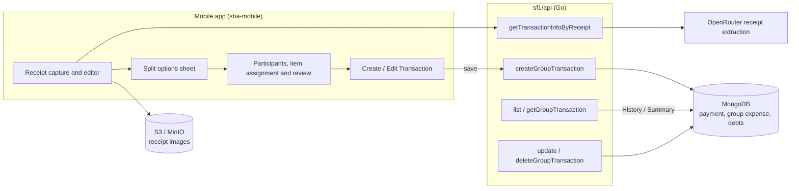
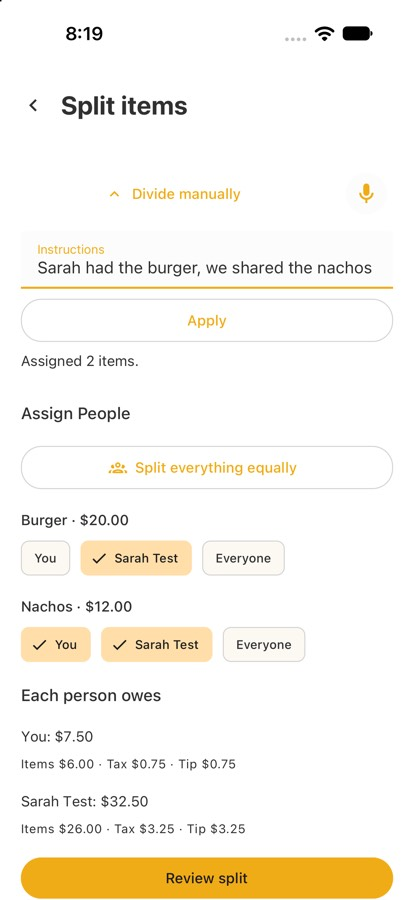
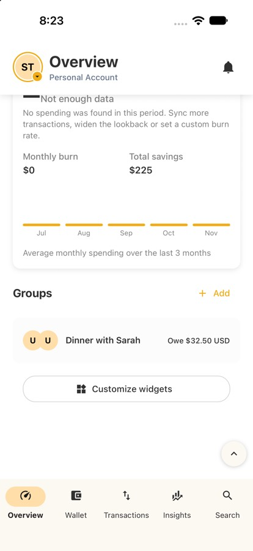
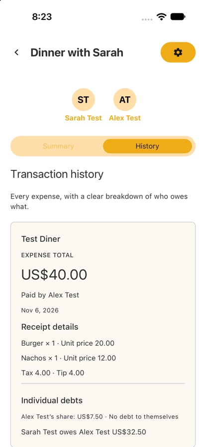

# Savi Finance — Group Split with Voice

> D4 project handoff. Implementation status is listed below; feature availability depends on the app build, backend and feature flags.

## Project

We are extending Savi Finance so people can split shared expenses, understand their own spending, and review who owes whom without maintaining a separate spreadsheet. Our team's work covers one-off splits, receipt/item splitting with voice or typed assignment, group transaction splits, and a balances overview.

**Implementation repository:** [Savi Finance's private monorepo](https://github.com/cheapreats/ce). Teaching staff need access to this repository to inspect the linked implementation PRs and evidence. The features described below are our team's contributions, not a description of the entire Savi product.

## Implementation Status (D4)

PR status checked on **November 27, 2026** in Savi's implementation repository:

- **Group and receipt splitting:** [#6761](https://github.com/cheapreats/ce/pull/6761) merged into `main` at commit [`b7f4d45aed`](https://github.com/cheapreats/ce/commit/b7f4d45aed91d4b218377b6f6fe645bd7f0dae07). The original receipt [#6759](https://github.com/cheapreats/ce/pull/6759) and group-transaction [#6760](https://github.com/cheapreats/ce/pull/6760) PRs are closed; their work was combined in #6761.
- **One-off split backend:** [#6605](https://github.com/cheapreats/ce/pull/6605), [#6606](https://github.com/cheapreats/ce/pull/6606), [#6607](https://github.com/cheapreats/ce/pull/6607), [#6608](https://github.com/cheapreats/ce/pull/6608) and [#6609](https://github.com/cheapreats/ce/pull/6609) merged into `main`.
- **One-off split mobile flow:** [#6768](https://github.com/cheapreats/ce/pull/6768) remains open against `main` and contains the full one-off mobile flow: the former editor PR [#6624](https://github.com/cheapreats/ce/pull/6624), own-share spending [#6769](https://github.com/cheapreats/ce/pull/6769), and guest invitations and participant emails [#7452](https://github.com/cheapreats/ce/pull/7452).
- **Owed/owing widget:** [#6770](https://github.com/cheapreats/ce/pull/6770) remains open against `main` and is gated by `mobile_split_balances`.

These are implementation/review statuses, not confirmation that a feature is available in Savi's released app. Current source links below use `main`; removed documents/components are explicitly linked as historical references.

**Partner-controlled deployment:** Our project extends Savi Finance's existing mobile app rather than introducing a separate application to host. Savi controls its private repository, hosted backend, app builds and public releases. For course review, we provide implementation PRs, local setup instructions, screenshots and demo recordings. We discussed this approach with our tutorial TA, Rayan, who approved using the linked development work and demo evidence to account for the partner-controlled release process.

## D4 Review Guide and Evidence

Start with the [current user workflows](#key-use-cases), [local setup](#development-requirements), [automated verification](#testing-infrastructure-tools-examples-and-commands) and [NFR evidence](#non-functional-requirements). Savi repository access is required for the implementation and PR evidence.

**Changes since the earlier demos:** The receipt flow now starts with capture and an editable preview. Split methods are grouped in a bottom sheet; group selection is searchable and excludes groups without another accepted member. Participant/item assignment and review use clearer labels, spacing and total/share hierarchy. The integrated save records the payment and debts, and group Summary offers full-share settlement marking. These changes incorporate partner feedback on placement, reuse and mobile readability.

**Receipt/group demo (approximately two minutes):** From Overview, add an expense, upload a receipt, check or correct the extracted values, choose a split method and group, assign individual/shared items, review and create the transaction, then show its group History. The [four-item example](#splitting-a-receipt-by-item-praneeth-shahmeer) was exercised with live OCR and a saved $33.28 debt. Test groups and accounts are local fixtures, not prerequisites tied to one developer's laptop.

### Screenshots and recording

The [merged integration PR #6761](https://github.com/cheapreats/ce/pull/6761) contains screenshots of the receipt flow, participant selection and light/dark saved results, plus the demo recording. Visual evidence stays in Savi's private repository and requires repository access.

**Receipt/group recording — manual entry and saving, 90 seconds (in [#6761](https://github.com/cheapreats/ce/pull/6761)):** Recorded November 25 against the local API. It shows a $35 receipt, two participants and $17.50 each. The recording ends while History loads; the saved-result screenshot shows the completed load. It predates the live four-item OCR verification and is not presented as a recording of that scan.

The current [one-off editor/save PR #6768](https://github.com/cheapreats/ce/pull/6768), [invitation PR #7452](https://github.com/cheapreats/ce/pull/7452) and [widget PR #6770](https://github.com/cheapreats/ce/pull/6770) retain their own feature screenshots and verification. Earlier D2/D3 videos are retained under [Previous deliverables](#previous-deliverables).

### Source checkpoints for review

These immutable references identify the reviewed source independently of later branch updates:

- **Merged group/receipt integration:** [`b7f4d45aed`](https://github.com/cheapreats/ce/commit/b7f4d45aed91d4b218377b6f6fe645bd7f0dae07), via #6761. The local D4 verification used a later `main` base, [`cf82059587`](https://github.com/cheapreats/ce/commit/cf820595874c484475ddd8f95f51ed5af08cf2e3).
- **One-off mobile flow, including own-share spending, guest invitations and participant emails:** [`544a41be85`](https://github.com/cheapreats/ce/commit/544a41be859bb087c2b5b8047b852a43385c0510), the fetched #6768 head on November 27.
- **Guest invitations and participant emails:** [`c0757ad323`](https://github.com/cheapreats/ce/commit/c0757ad323cd545e2620946eace66b0234d8920a), the final #7452 head, merged into the #6768 branch on November 27.
- **Owed/owing widget:** [`d0966b3d61`](https://github.com/cheapreats/ce/commit/d0966b3d61a8d210acdb36c9354d3d705a1b5e28), the fetched #6770 head on November 27.

The open PR checkpoints are separate review branches, not a claim that all features are in one released build. The local demo also used layout and connection-retry adjustments awaiting a separate implementation commit. The course repository versions the handoff documentation; Savi's repository retains the implementation history.

## Key Use Cases

### Splitting a one-off expense (David, Shaun)

**Why:** split a shared purchase without creating a group, and track your own spending separately from the full payment.

**What it does** (development flow in #6768, with own-share spending from #6769):

- Splits a personal expense with eligible Savi users or saved guests using equal shares, amounts or percentages. People search is limited to people connected through a shared household, group or organization.
- Validates allocations in exact cents. Amount mode offers an explicit adjustment to your share for differences of up to $1; larger differences must be corrected.
- Saves the split with the transaction; **Manage split** lets the payer change or remove it later.
- Counts the payer's share in Spending and budget alerts while Wallet keeps the full payment: a $120 expense split equally between two people contributes $60 to the payer's spending.

**How to try it** (use the #6768 development branch and compatible backend, with identity-based split saving enabled):

1. Tap **Add transaction → Expense**, enter the name, amount and date, and choose an account owned by your personal profile.
2. Tap **Split → Total with Others**. Under **Add people**, search for and select another eligible person or saved guest.
3. Choose **Equal**, **Amount** or **Percentage**. In amount/percentage mode, tap a person's share to edit it; review the resulting allocations.
4. Tap **Apply**, then **Create** to save the transaction. Applying alone only updates the draft.
5. Reopen the transaction through **Edit → Manage split** to change the split. Removing the other participants exposes **Remove split**; save the transaction to confirm the removal.
6. Compare **Wallet** with **Insights → Spending** to see the full payment versus your share. This requires the own-share spending changes included in the #6768 branch through #6769.

**Guest invitation extension (#7452):** On the #6768 branch, the payer can create a guest and use **Share invite** with an email address. The recipient opens the link, signs in with the matching verified email and claims their shares. Sharing uses the native share sheet; it does not itself send an invitation email. Separate participant notification emails are default-off. This extension merged into the #6768 branch on November 27 and is not in `main` until #6768 merges.

**Development status:** The mobile editor and saving work are combined in open PR [#6768](https://github.com/cheapreats/ce/pull/6768); own-share spending [#6769](https://github.com/cheapreats/ce/pull/6769) has merged into that branch. The flow remains development-gated. Guest invitations and participant emails [#7452](https://github.com/cheapreats/ce/pull/7452) have also merged into that branch. See those PRs for current checks and verification limits; these changes do not transfer money.

**Screenshots, video and implementation:** [Editor and saving #6768](https://github.com/cheapreats/ce/pull/6768), [own-share spending #6769](https://github.com/cheapreats/ce/pull/6769), [guest invitations and participant emails #7452](https://github.com/cheapreats/ce/pull/7452). The closed [editor preview #6624](https://github.com/cheapreats/ce/pull/6624) is historical evidence.

### Splitting a receipt by item (Praneeth, Shahmeer)

**Why:** People order different things and share some items. Receipt splitting lets the payer capture the bill, correct the extracted details and assign each item without re-entering the expense in a separate app.

**What it does:**

- Starts from **Add transaction → receipt/camera button**. Capture or upload a receipt, then review its image and extracted details; manual entry is also available.
- Lets the user correct the receipt title, item names, unit prices, quantities, tax and tip before saving. Discounts and tax-inclusive prices are available through the receipt options menu. The editor calculates the total from the corrected values and retains the scanned total for comparison.
- Offers **Ask Savi**, **Assign by voice** when enabled, **Split equally**, and **Assign items manually** from the receipt's split-options sheet. Ask Savi opens Savi's existing chat with receipt context; it does not confirm or save the split. **Don't split** returns the full amount to the transaction draft.
- Shows joined groups with at least two accepted members, then lets the payer choose who participated in this expense. Pending invitees cannot participate.
- Assigns items by tapping people, typing instructions or supplying a voice transcript. Shared items divide evenly; tax and tip follow each person's item subtotal. Integer-cent allocation keeps the shares equal to the confirmed total.
- Reviews each person's share before returning it to the transaction. **Create** saves the payment, receipt details and group debts, which appear in group History and Summary.

**How to try it** (use a development app and local backend containing merged PR #6761):

1. Have a group with the payer and at least one accepted member. If necessary, enable `group_card` under **Diagnostics → Feature Flags**, create a group from **Overview → Groups**, and invite the other user through group settings → **Invite member**. They accept through **Notifications → Join**.
2. From **Overview**, tap **Add transaction → Expense**, then the receipt/camera button. Take a photo or select one from Photos. Alternatively, use **Enter manually** in the receipt flow.
3. Review the receipt. Use **Edit receipt** to correct line items, quantities, tax or tip; use **Preview** to return to the receipt summary. Tap the receipt title to rename it if needed.
4. Tap **Split receipt → Assign items manually**, choose the group, select the participants on **Who's splitting?**, then tap **Continue**.
5. On **Split items**, tap the people who share each item. **Everyone** shares that item with all selected people; **Split equally** assigns every item to everyone. Alternatively, open **Assign by text**, enter a sentence such as "I had the burger, Alex had the pasta, we shared the nachos and drinks", and tap **Apply**. Check the assignments before continuing.
6. Tap **Review split**, check the total and individual shares, then **Use split in transaction**. This returns to the transaction draft; it has not saved yet.
7. Confirm the transaction name, currency and payer-owned funding account, then tap **Create**. Open the group's **History** for the saved receipt and individual debts, or **Summary** for outstanding balances.

**Verified D4 example:** Live photo-library upload and OpenRouter extraction were exercised in the iOS simulator with a synthetic four-item receipt: Burger $18, Pasta $16, Nachos $12 and Drinks $8, plus $7.02 tax and $8.10 tip, totaling **$69.12**. Assigning the burger to the payer, pasta to the other person and sharing nachos/drinks produces **$35.84** for the payer and **$33.28** owed by the other person. The saved receipt and debt were verified in group History. This is local test data, not a real purchase or a production-release verification.

**Limits and recovery:**

- Live extraction requires a valid backend OpenRouter key and provider access. The configured route is `openai/gpt-6-luna` through `azure/us`. A failed scan can be retried or continued through manual entry; OCR output must still be checked. The synthetic demo does not establish accuracy across all real receipt photos or verify physical camera capture.
- Voice assignment requires the mobile voice feature to be enabled and microphone/speech access. Real-device microphone behavior remains unverified. Typed assignment uses the on-device parser and needs no live model call; unmatched instructions require correction. Ask Savi is a separate online service.
- Empty or invalid items and incomplete assignments prevent split confirmation. Uncertain OCR values can be corrected before saving; choosing another group does not save an expense.
- Completed receipt item/assignment editing after save, automatic group budget-share attribution and post-save receipt notifications are not claimed as complete. The steps above cover creating a receipt expense, not every existing-transaction attachment/edit path. Recording debts does not transfer money.

**Implementation and evidence:** [Merged group/receipt integration #6761](https://github.com/cheapreats/ce/pull/6761). The [D3 walkthrough](https://drive.google.com/file/d/1_RcoIVwYVeFO3oh8SeUBXMU0YUKbhP6R/view?usp=sharing) and [original receipt PR #6759](https://github.com/cheapreats/ce/pull/6759) retain earlier development evidence; their screen layouts predate the current flow.

### Splitting a transaction with a group (Sumedh, Pranay)

**Why:** when one person pays for a shared expense, the app has to remember who owes what, or the split disappears as soon as the screen closes. Saving each person's share on the server is what lets Savi show balances and history, and keeps two people (or two devices) from overwriting each other's edits.

**What it does:**

* Creating a group expense saves a debt record for each non-payer participant with a positive amount owed. The payer's own share is what is left of the total (a $12 expense shared by the payer and one member saves a single $6 debt, and no debt to oneself), and shares can add up to less than the total but never more.
* Sending the same create request twice, such as a retry after an uncertain submission, returns the existing expense instead of creating a duplicate.
* The caller must have an editing role in the group, and each participant must be an accepted member. Only the payer needs a funding account; if another participant's account is supplied, its ownership is checked.
* Deleting an expense also deletes its shares, and editing the total can't go below what is already assigned to people.
* Getting or listing group expenses returns who owes what, which is what the History and Summary screens read.
* Each expense has a version number. An edit or delete can send the version it last saw, and if someone changed the expense in the meantime, it is refused with "changed by someone else" and nothing is overwritten.

**How to try it** (development app and backend containing merged PR #6761, with `group_card` enabled):

1. Create a group from the Groups section and invite a friend. They accept it from the bell icon (Notifications → Join). Only the payer needs a funding account; the friend can participate without linking a bank account.
2. Open the group and tap New Transaction.
3. Enter the description and total, choose your payer-owned funding account, and select the accepted members who shared the expense. The account determines the currency.
4. Choose **Even**, **Amounts** or **Percentages**, enter any custom shares, and check the expense preview.
5. Tap **Create**. Open **History** to see the saved expense and individual debts, or **Summary** for outstanding balances. These are saved on the server and remain after reopening the app.
6. Once a person has repaid you outside Savi, the payer can use **Mark [person] settled** in Summary and confirm it. This records settlement of that person's full share; it does not send money.

**Limits:** Full-share settlement marking is available to the payer. Partial-repayment entry and settlement reversal are not exposed in this group screen. General mobile editing/deletion of group expenses and attaching existing transactions are not demonstrated as complete; backend update/delete and revision checks do not by themselves provide those user workflows. Automatic personal-budget attribution for group debts and post-save notifications also remain outside the verified flow.

**Implementation and evidence:** [Merged integration #6761](https://github.com/cheapreats/ce/pull/6761); [original group transaction PR #6760](https://github.com/cheapreats/ce/pull/6760) retains earlier screenshots and verification.

### Group split integration (Praneeth, Shahmeer, Sumedh, Pranay)

The four-person group split team combined the receipt and transaction-splitting pairs' work in [#6761](https://github.com/cheapreats/ce/pull/6761), which is now merged into **`main`**. The original PRs and commits remain linked as contribution evidence.

**What was integrated and how it works:**

- Both flows use the same group members, shared expense storage, debt records and History/Summary screens. Transaction splitting produces shares from a total; receipt splitting produces shares from item assignments and proportional tax/tip.
- Receipt review passes the confirmed allocation back to Create/Edit Transaction. Create/Save then calls the shared group-saving API, creates or links one full personal payment, and records debts for the other participants. Receipt items, quantities, discounts and assignments are retained with the group expense.
- Repeating an unchanged receipt save reuses its request identity to avoid duplicate payments and debts. Backend retry recovery is separate from the user-facing History screen; a general History action for reopening or editing a saved receipt is not claimed.
- The verified local example is a $35 receipt split between two people: one $35 personal payment, a $17.50 payer share and a $17.50 debt shown in group History/Summary. This records obligations; it does not transfer money.

**Integration PR and verification:** [Savi PR #6761](https://github.com/cheapreats/ce/pull/6761). Merged into `main` on November 25, 2026 (Toronto time), at [`b7f4d45aed`](https://github.com/cheapreats/ce/commit/b7f4d45aed91d4b218377b6f6fe645bd7f0dae07). The earlier D2 checkpoint remains linked below as historical evidence; further changes can be reviewed in separate PRs.

### Owes / Owed Widget (Sambhav)

**Why:** Savi users can see where they stand on the home screen, without checking each group or transaction.

**What it does:**

- Adds a **Splits** card to the Overview with two totals: **Owed to you** and **You owe**.
- Combines one-off splits from your own transactions with group splits.
- Tap a total to see the breakdown **by person** and **by group**; group balances name the person you owe.
- Mark a person's balance as **resolved** on this device and **undo** it if you made a mistake.
- Resolved balances drop out of the widget totals but stay in its **Resolved** history list. These selections are stored locally per signed-in user; they do not update the group's server-side settlement state.

**How to try it** (use the #6770 development branch and compatible backend):

1. Turn on the card: **Account → Diagnostics → View All Flags**, then switch on `mobile_split_balances`.
2. Go to **Overview** and scroll to the **Splits** card.
3. Tap **Owed to you** or **You owe** to see the breakdown by person and by group.
4. Tap **Resolve** next to a person: the total drops and they move to **Resolved**.
5. Tap **Undo** in the Resolved list to bring the balance back.

**Limits:** Resolve/Undo does not transfer money or synchronize settlement across devices. The widget shows the selected currency's total and lists other currencies separately rather than adding unlike currencies together.

**Implementation and screenshots:** [Savi pull request #6770](https://github.com/cheapreats/ce/pull/6770) (open; this widget requires the PR branch and feature flag).

## Architecture and Design

The shipped group and receipt splitting work ([#6761](https://github.com/cheapreats/ce/pull/6761), merged into `main`) extends Savi's existing stack rather than adding a new service: a **React Native/Expo** mobile app (TypeScript, Redux), a **Go** API built with **Bazel**, **MongoDB**, and **S3/MinIO** for receipt images. Receipt reading uses **OpenRouter** from the backend only.



**How a save works:** the receipt and group transaction flows both produce one share per person, so they share a single save path. Receipt review returns the confirmed allocation to Create/Edit Transaction; **Create** calls `createGroupTransaction`, which records one full personal payment for the payer and a debt for each other participant. Receipt items, quantities, discounts and assignments are kept with the group expense, and History and Summary read the result through `listGroupTransactions` and `getGroupTransaction`.

**Design decisions:**

- **One save path for both flows.** Item assignments and total-based splits are converted to the same per-person shares before saving, so History, Summary and debt records use a single data model.
- **Staged, retry-safe receipt saves.** A receipt save moves through `PAYMENT_PENDING → DEBTS_PENDING → COMPLETE` and reuses its request identity, so a repeated or interrupted save does not create duplicate payments or debts.
- **The server re-validates everything.** The app calculates shares in integer cents so users see exact amounts, but the backend independently checks receipt totals, item identities, quantities, allocations, group membership and payer-account ownership.
- **Edits cannot silently overwrite each other.** Each group expense carries a revision; an update or delete sent with an older `expectedRevision` is rejected as changed by someone else.
- **Receipts stay private.** The group-visible receipt snapshot stores an attachment ID rather than the payer's file object or signed download URL, and the OpenRouter key never leaves the backend.

The full RPC contracts are documented in Savi's generated [API reference](https://github.com/cheapreats/ce/blob/main/sf1/api/API_DOC.md).

## Task Management

The team uses **Jira for ticketing and task distribution and Slack for asynchronous communication**, through Savi Finance's internal platforms.

## Access and Use

This course repository contains the project documentation; the implementation lives in [Savi's private monorepo](https://github.com/cheapreats/ce). Teaching staff have been given access to inspect the implementation PRs and evidence. New contributors need access from Savi before following the [development setup](#development-requirements).

The group/receipt flow can be run locally from `main` with the mobile app and backend on the same revision. Features whose PRs remain open require their corresponding development branches; see [Implementation Status](#implementation-status-d4). Installing the public Savi app alone is not a reliable way to reproduce all submitted features. Historical D1 prototype information is in the [mockup instructions](deliverables/D1/mockup.md).

### Partner handoff and release responsibility

- **Code:** Contributions already live in Savi's repository, so there is no separate application repository to transfer. Merged work stays in `main`; open PRs retain the remaining code, review discussion and verification evidence.
- **Documentation:** This README provides feature workflows, dependencies, setup and test instructions, with links to Savi's own developer documentation. The linked PRs retain screenshots, recordings and implementation-specific review notes for future maintainers.
- **Builds and release:** Savi's maintainers control the existing Expo/EAS build and distribution process and the corresponding backend deployment. Development and production build profiles are defined in [eas.json](https://github.com/cheapreats/ce/blob/main/sba-mobile/eas.json); the [CI/CD section](#cicd-pipeline) links the build workflows. Our handoff uses that existing process rather than transferring a separately hosted product.
- **Verification:** A merged PR or passing CI is evidence about the code revision. Availability to users also requires the appropriate app build, compatible deployed backend and enabled feature flags. We do not claim a particular public release contains all of our work without verifying that build.

### Points of contact

- **Product and merging:** Savi Finance, partner representative Ralph Maamari. Savi's engineers review and merge all implementation PRs.
- **Receipt splitting:** Praneeth, Shahmeer.
- **Group transaction splitting:** Sumedh, Pranay.
- **Owed/owing widget:** Sambhav.

### Known issues and next steps

| Area | Known issue | Suggested next step |
|---|---|---|
| Receipt splitting | Accuracy on real receipt photos and physical camera capture are unverified | Test with real receipts and add them as extraction test fixtures |
| Receipt splitting | Real-device microphone behavior for voice assignment is unverified | Test voice assignment on physical iOS and Android devices |
| Receipt splitting | Saved receipt items and assignments cannot be edited after saving | Add an edit flow that reuses the existing review screens |
| Group transactions | The app has no screens for editing or deleting a group expense | Build them on the existing `updateGroupTransaction` / `deleteGroupTransaction` RPCs, which already check revisions |
| Group transactions | Partial repayments and settlement reversal are not exposed | Extend the Summary screen's settlement action |
| Group transactions | Group debts are not attributed to personal budgets, and no notification is sent after saving | Reuse Savi's existing budget and notification pipelines |
| Owed/owing widget | [#6770](https://github.com/cheapreats/ce/pull/6770) is not merged; Resolve/Undo is stored only on the device | Merge #6770, then connect Resolve to server-side settlement |
| CI | The final head of #6761 recorded a failing static-gates check | Fix the static-gates failure in a follow-up PR |

## Development Requirements

The implementation runs from Savi's private monorepo, not this documentation repository. Start with [Savi's backend setup](https://github.com/cheapreats/ce/blob/main/dev/README.md) and [mobile setup](https://github.com/cheapreats/ce/blob/main/sba-mobile/README.md). They remain the source of truth for supported tool versions and native build configuration.

**Prerequisites:** repository access, Node.js/npm, Go/Bazel, Docker and the platform's native tools. iOS simulation requires macOS/Xcode; Android requires the Android development tools. Use an Expo **development build**, since Expo Go does not contain Savi's native modules.

### Start the group/receipt development flow

1. Clone `cheapreats/ce` and check out `main` containing merged PR #6761. Keep the mobile app and backend on the same revision. For an open feature, use its branch from [Implementation Status](#implementation-status-d4) instead.
2. Start Docker. From the implementation repository root, run `make dev-up` in a dedicated terminal; it starts local services, prepares missing environment files and seeds the database. In another terminal, run `make dev-status`. The default API health endpoint is `http://localhost:8080/healthz`.
3. Follow the mobile guide to configure local HTTPS/OAuth and trust the development certificate on the simulator or test device. Run `make dev-mobile` from the root to write the mobile app's local API configuration. The app normally targets Savi's hosted API, so this step matters even when the local server is running.
4. In `sba-mobile/`, run `npm ci`. Install a matching development client using Savi's internal build or build locally with `npm run ios` / `npm run android`. Start Metro with `npx expo start --dev-client --clear`; use `--port 8082` if the default port is occupied. Run one Metro instance for the checkout and connect the client to it.
5. Sign in using Savi-approved local test accounts. The local seed includes `alextest1@financesavi.com` and `sarahtest2@financesavi.com`; use the local authentication setup, not production credentials. Enable `group_card` if needed, create/join a group and choose a payer-owned account. Another developer's prepared demo group is not automatically present on your machine.
6. Follow the [receipt workflow](#splitting-a-receipt-by-item-praneeth-shahmeer) or [group transaction workflow](#splitting-a-transaction-with-a-group-sumedh-pranay). Save a synthetic expense and confirm it appears in group History before using the setup for a demo.

### Live receipt extraction and local test mode

Local services default to fake-provider settings. For **live OCR**, configure the backend's ignored `sf1/api/.env`:

```dotenv
OPEN_ROUTER_API_KEY=<approved development key>
OPEN_ROUTER_FAKE_MODE=
```

Restart your checkout's API with `make dev-restart-api` after changing these settings. The model (`openai/gpt-6-luna`) and provider (`azure/us`) are configured in code. Confirm the app targets your local HTTPS API: changing a local key has no effect on Savi's hosted backend. Manual entry and typed assignment do not require an OpenRouter key. Voice transcription has its own provider configuration; an OCR key alone does not enable live speech recognition.

For automated receipt/API tests, use `OPEN_ROUTER_FAKE_MODE=hermetic` and restart the API. Keep live-provider and hermetic test sessions separate so tests remain repeatable and avoid paid inference.

### Troubleshooting and continuing development

- **Blank app, stale screens or connection warning:** check `make dev-status`, the Metro terminal and the configured API origin. Restart Metro after changing its environment. A native dependency change requires a matching development client rebuild; clearing the JavaScript cache alone does not rebuild native modules.
- **Receipt upload works but extraction fails:** inspect `dev/.logs/sf1-api.log` for the provider error, check the key and fake-mode setting, then retry or enter items manually. Do not paste credentials into issues, PRs or screenshots.
- **No selectable groups:** the receipt picker requires the signed-in user and another accepted member. Accept the invitation and refresh the group list.
- **Preserve local data:** `make dev-down` stops the stack while retaining data. `make dev-reset` and `make dev-teardown` remove local data; they are not routine restart commands. Check which checkout owns the services before stopping them.
- **Where to maintain the feature:** receipt screens/calculations are in `sba-mobile/screens/groups/`, shared controls in `sba-mobile/components/groups/`, draft state in `sba-mobile/redux/slices/receiptSplitSlice.ts`, and save/validation logic in `sf1/api/rpc/handlers/create_group_transaction/`. Add regression coverage alongside the affected component and follow Savi's PR review process.

The [historical receipt handoff](https://github.com/cheapreats/ce/blob/a12f185180bfb184d44a41fea79c1eb595d069a6/sba-mobile/screens/groups/RECEIPT_SPLIT_HANDOFF.md) records earlier development decisions; the current workflow and setup are documented here and in Savi's maintained guides.

## External Dependencies

Our split workflows extend Savi's existing application stack and APIs. Local manual-expense demos do not require live banking connections.

### Application and Framework Dependencies

- **React Native** — used to build the Savi mobile application.
- **Expo / EAS** — used for local mobile development and mobile builds/deployment.
- **Go + Bazel** — used for Savi's backend services and build system.
- **MongoDB** — Savi's primary database.

### Internal APIs and Services

- **`sf1/api`** — Savi's main backend API, which the mobile application uses to communicate with backend functionality.
- **Existing transaction and receipt services** — reused for personal payment creation/editing, receipt extraction and attachment handling.
- **On-device voice/typed assignment parser** — maps spoken or typed item assignments to receipt participants. Voice follow-ups and model-based assignment fallback remain separate work.

### Third-Party Services and APIs

- **Plaid** — Savi's existing banking data provider and may be relevant for transaction-based splitting.
- **OpenRouter / OpenAI on Azure** — receipt image extraction uses `openai/gpt-6-luna` through OpenRouter's `azure/us` route. Manual receipt entry remains available without this service.
- **AWS S3 / local MinIO** — Savi's attachment storage and its local development equivalent.
- **GitHub Actions** — used as part of Savi's CI/CD process.

Live service credentials and environment configuration follow Savi's setup instructions and remain outside this course repository.

## GitHub Workflow

Implementation work stays on feature branches in Savi's monorepo and is submitted through PRs following the company's review and merge practices. The original receipt and group transaction PRs remain as individual contribution evidence; their combined integration (#6761) has merged into `main`. Savi controls review and merging into its production codebase. Course documentation is maintained separately in this repository through team branches and PRs.

## Development Process and Infrastructure

Since we are adding features to Savi's existing app, we use the company's development and testing setup. Our work includes adding tests for our split features, checking that the two group split flows work together, and testing the app in the simulator. The links below point to the implementation repository, which teaching staff have been given access to.

### CI/CD Pipeline

When we open or update a pull request, GitHub Actions runs checks on the affected parts of the app. For the mobile app, these include TypeScript checks for type errors, ESLint for code issues, and Jest for automated tests. For the server, Bazel builds the changed code and runs the relevant Go tests. Other checks look for formatting problems, accidentally committed secrets and security issues.

The [Required Checks workflow](https://github.com/cheapreats/ce/blob/main/.github/workflows/required-checks.yaml) chooses which checks to run, and the [CI PR workflow](https://github.com/cheapreats/ce/blob/main/.github/workflows/ci_pr.yaml) defines the mobile and server checks. Results can be viewed in the [Actions tab](https://github.com/cheapreats/ce/actions) or directly under [Checks on our integration PR](https://github.com/cheapreats/ce/pull/6761/checks). The [CI Main workflow](https://github.com/cheapreats/ce/blob/main/.github/workflows/ci_main.yaml) also runs when relevant changes reach `main`.

Savi controls when changes are merged and released to users. Its [iOS app build](https://github.com/cheapreats/ce/blob/main/.github/workflows/expo_build_ios.yaml) and [development app build](https://github.com/cheapreats/ce/blob/main/.github/workflows/expo_build_mobile_dev.yaml) are started manually through GitHub Actions. They then use Expo's EAS service to build the app, with build settings in [eas.json](https://github.com/cheapreats/ce/blob/main/sba-mobile/eas.json). The EAS configuration includes development/internal and production profiles; mobile builds are started manually by Savi, so app releases are not automatic.

**Deployment:** Savi's production backend (`sf1/api` on Railway) is configured to build and deploy from `main` ([Railway configuration](https://github.com/cheapreats/ce/blob/main/.railway/README.md)), so a merged backend change such as #6761 is deployed without a manual step. Development runs locally through Docker (`make dev-up`); Railway's development environment hosts only databases, so there is no second automatically deployed application environment. Savi controls both deployment and app distribution.

The linked workflows use Savi's self-hosted Azure runners, dependency caches, changed-file filters, concurrency cancellation and explicit job timeouts. Job limits vary by workload, including longer native/backend builds. Savi owns these resource settings; this course repository adds no duplicate application CI or scheduled build jobs.

**Recorded CI evidence:** The merged integration PR's final head [`44a741294c`](https://github.com/cheapreats/ce/commit/44a741294c276766c14b2add0bd0467021a1d5f7) has 10 successful, 7 skipped and 2 failed check runs as inspected on November 27. The failures are the [static-gates job](https://github.com/cheapreats/ce/actions/runs/45752249854/job/139682635833) and its Required Checks aggregate. The PR is merged, but that is not described here as an all-green CI run. Results are specific to their recorded revision.

### Testing Infrastructure: Tools, examples and commands

We use a few types of tests because checking the split calculations alone would not tell us whether the screens and saving flow work:

- **Unit tests** check individual calculations and validation rules. The mobile app uses [Jest with `jest-expo`](https://github.com/cheapreats/ce/blob/main/sba-mobile/package.json), while the server uses Go's built-in `testing` package through Bazel.
- **Screen tests** use React Native Testing Library to simulate actions such as tapping a person's name or entering an assignment. They check the displayed result, updated selections and navigation between screens. An example is [ReceiptSplitAssignmentScreen.spec.tsx](https://github.com/cheapreats/ce/blob/main/sba-mobile/screens/groups/ReceiptSplitAssignmentScreen.spec.tsx).
- **API tests** send requests to a local server and check what is saved in the database. Savi calls these [hermetic tests](https://github.com/cheapreats/ce/blob/main/smoke-tests/hermetic/README.md). They use Jest, temporary test users and local services started with Docker. The selected receipt tests use fake-provider responses; check the configured providers before running broader definitions. Live OCR verification is separate from these deterministic tests.
- **Manual tests** let us check the complete app flow in the simulator: upload a receipt, correct its fields, choose people, assign items, review the split and save it. Screenshots and videos are included in our feature PRs. These checks exercise the user workflow separately from tests that supply a transcript or mock API response.

Some examples of tests we added are:

1. Shared items, tax, tip and leftover cents add up to the receipt total, and tax already included in prices is not added twice ([split calculation tests](https://github.com/cheapreats/ce/blob/main/sba-mobile/screens/groups/receiptSplitAllocation.spec.ts)).
2. Invalid prices, quantities and discounts prevent the user from confirming an incorrect split ([receipt validation tests](https://github.com/cheapreats/ce/blob/main/sba-mobile/screens/groups/receiptSplitDraft.spec.ts)).
3. An assignment with an unclear name or item asks for correction instead of assigning it to the wrong person ([assignment tests](https://github.com/cheapreats/ce/blob/main/sba-mobile/components/groups/voiceAssignment.spec.ts)).
4. Receipt reading keeps the cents in a price and leaves uncertain values for the user to correct ([receipt extraction tests](https://github.com/cheapreats/ce/blob/main/sf1/api/rpc/handlers/get_transaction_info_by_receipt/analysis_test.go)).
5. Saving a split creates the correct amounts owed by each person, without creating a debt to the payer themselves ([saved-share tests](https://github.com/cheapreats/ce/blob/main/sf1/api/rpc/handlers/create_group_transaction/debt_rows_test.go)).
6. Retrying a receipt save does not create another payment or duplicate what people owe ([save-flow API test](https://github.com/cheapreats/ce/blob/main/smoke-tests/hermetic/definitions/createGroupTransaction-rpc.hermetic.ts)).

**D4 focused verification (November 27): 159 tests passed across eight suites** in the local checkout based on [`cf82059587`](https://github.com/cheapreats/ce/commit/cf820595874c484475ddd8f95f51ed5af08cf2e3). This selection covers receipt allocation/validation, typed assignment, receipt screens, split options, native keychain settings and attachment-link refresh. Run it from `sba-mobile/` after `npm ci`; it does not need a running API or a live OpenRouter key:

```sh
node --max-old-space-size=2048 node_modules/jest/bin/jest.js --runInBand --runTestsByPath \
  screens/groups/receiptSplitAllocation.spec.ts \
  screens/groups/receiptSplitDraft.spec.ts \
  components/groups/voiceAssignment.spec.ts \
  screens/groups/ReceiptSplitAssignmentScreen.spec.tsx \
  screens/groups/CreateReceiptSplitScreen.spec.tsx \
  components/groups/SplitOptionsSheet.spec.tsx \
  shared/utils/keychainOptions.spec.ts \
  shared/utils/files/displayUtils.spec.ts
```

The earlier D3 selection passed 66 tests at [`8396ef5da`](https://github.com/cheapreats/ce/commit/8396ef5dab647766648fefe924c5974d90615c32). Test counts refer to those specific selections and revisions, not the full monorepo suite.

To run the server tests, follow Savi's Go/Bazel setup, then run these commands from the implementation repository root:

```sh
cd sf1
bazel test --jobs=2 \
  //api/rpc/handlers/create_group_transaction:create_group_transaction_test \
  //api/rpc/handlers/get_transaction_info_by_receipt:get_transaction_info_by_receipt_test
```

The API tests need the local server and database running. Follow the [backend setup guide](https://github.com/cheapreats/ce/blob/main/dev/README.md), check the services with `make dev-status`, and set `OPEN_ROUTER_FAKE_MODE=hermetic` in the backend environment before restarting it. Then run:

```sh
cd smoke-tests/hermetic
npm ci
npm run test:hermetic:filter -- 'createGroupTransaction|getTransactionInfoByReceipt|uploadFile'
```

Savi also provides `make presubmit`, run from the implementation repository root, for its broader set of checks. Our PRs provide current verification details; the [historical handoff document](https://github.com/cheapreats/ce/blob/a12f185180bfb184d44a41fea79c1eb595d069a6/sba-mobile/screens/groups/RECEIPT_SPLIT_HANDOFF.md) records results and limitations from its original development revision.

### Pull requests and code review

We work on feature branches and use pull requests to explain our changes and request review. The main links for the two group split flows are [receipt splitting #6759](https://github.com/cheapreats/ce/pull/6759), [group transaction splitting #6760](https://github.com/cheapreats/ce/pull/6760) and [integration #6761](https://github.com/cheapreats/ce/pull/6761). These pages show the code, descriptions, check results and any review comments or approvals. The integration PR #6761 has merged; the original #6759 and #6760 PRs are closed historical references. Savi controls review and release of subsequent changes.

### Environment setup and secrets

Savi provides configuration templates for the [mobile app](https://github.com/cheapreats/ce/blob/main/sba-mobile/.env.example) and [server](https://github.com/cheapreats/ce/blob/main/sf1/api/.env.example). These show the settings needed to run the project without including real keys. The [Docker Compose file](https://github.com/cheapreats/ce/blob/main/dev/docker-compose.yml) starts local versions of services such as the database and receipt storage. The setup steps are linked under [Development Requirements](#development-requirements).

We keep development keys in local environment files that Git ignores. The OpenRouter key stays on the server, since settings prefixed with `EXPO_PUBLIC_*` are included in the app and are visible to users. Savi's build workflows read release credentials from GitHub Actions secrets, including the Expo token used to build the app.

## Non-Functional Requirements

Our receipt/group split work addresses accessibility, readability, secure data handling and reliable saving through the following concrete changes.

### Accessibility and readability

- **Descriptive controls and state:** Receipt fields, remove-item actions and split options have accessibility labels. Item chips identify both the item and person, such as "Burger: Sam", and expose their selected state. Section titles use heading roles; decorative icons are hidden from assistive technology to avoid duplicate announcements. [Assignment screen tests](https://github.com/cheapreats/ce/blob/main/sba-mobile/screens/groups/ReceiptSplitAssignmentScreen.spec.tsx) check the labelled controls and selection changes, while [split-options tests](https://github.com/cheapreats/ce/blob/main/sba-mobile/components/groups/SplitOptionsSheet.spec.tsx) cover the available actions.
- **Larger text layouts:** The [receipt editor](https://github.com/cheapreats/ce/blob/main/sba-mobile/screens/groups/ReceiptSplitEditor.tsx) and [split summary](https://github.com/cheapreats/ce/blob/main/sba-mobile/components/groups/SplitSummary.tsx) read the system font scale and switch to stacked layouts at the shared large-text threshold. This gives fields and share amounts more space rather than forcing them into the normal horizontal rows.
- **Clear visual hierarchy:** The review separates the receipt total, participant names and owed amounts from the item/tax/tip breakdown. Shared theme colors support light and dark presentation, and text such as "Your share" and "owes you" communicates meaning without relying on color alone. Split methods use left-side icons and plain labels; advanced controls are grouped into sheets or the receipt menu.
- **Actionable feedback:** Invalid amounts have field-specific messages and accessibility hints. For example, negative tax prompts "Enter a non-negative amount with up to two decimal places." Errors clear after correction and use alert roles/polite live updates where configured. The empty editor shows a neutral "No items yet" state; an unsuccessful scan offers retry or manual entry. [Receipt screen tests](https://github.com/cheapreats/ce/blob/main/sba-mobile/screens/groups/CreateReceiptSplitScreen.spec.tsx) cover error hints, correction and empty-state behavior.

### Secure data handling and authorization

- **Server-side secrets and protected sessions:** OpenRouter credentials remain in the backend's ignored environment configuration, never in `EXPO_PUBLIC_*` client settings. We reuse Savi's native session storage and [Expo SecureStore keychain options](https://github.com/cheapreats/ce/blob/main/sba-mobile/shared/utils/keychainOptions.ts), including device-only accessibility settings. Existing keychain behavior is covered by the focused test selection below.
- **Private receipt attachments:** Group-visible receipt snapshots retain an attachment ID rather than copying the payer's full File object or signed download URL. [GroupReceiptSnapshot and response serialization](https://github.com/cheapreats/ce/blob/main/sf1/api/models/group_transaction.go) apply this rule to responses, including older snapshots; [regression tests](https://github.com/cheapreats/ce/blob/main/sf1/api/models/group_transaction_test.go) check that private URL/metadata and internal retry payloads are excluded. The [attachment viewer](https://github.com/cheapreats/ce/blob/main/sba-mobile/components/transactions/attachments/TransactionAttachmentPreview.tsx) reuses Savi's HTTPS preview flow and refreshes stale file links.
- **Authorization and input validation:** Group saving checks the caller's access, accepted membership and payer-account ownership. The backend independently [validates receipt totals, item identities, quantities and participant allocations](https://github.com/cheapreats/ce/blob/main/sf1/api/rpc/handlers/create_group_transaction/receipt_validation.go), so client-side checks are not the sole protection. User-facing validation messages explain the correction required.

### Reliability and recoverability

- **Exact money calculations:** Allocation uses integer cents and deterministic rounding, with tests for shared items, proportional tax/tip, discounts and tax-inclusive receipts. The review must reconcile before a split can be confirmed.
- **Retry-safe writes:** A stable request identity prevents repeated receipt submissions from creating duplicate payments or debts. The [receipt save handler](https://github.com/cheapreats/ce/blob/main/sf1/api/rpc/handlers/create_group_transaction/receipt.go) tracks save progress, while revision checks protect supported group mutations from conflicting updates. The [hermetic save tests](https://github.com/cheapreats/ce/blob/main/smoke-tests/hermetic/definitions/createGroupTransaction-rpc.hermetic.ts) exercise persistence and retries.

**Evidence:** The [D4 focused test selection](#testing-infrastructure-tools-examples-and-commands) passed **159 tests across eight suites on November 27**, including accessible selection state, receipt-field error correction, split-option controls, keychain configuration and stale attachment handling. The implementation PRs retain simulator screenshots and recordings; the four-item live OCR/save example above supplies end-to-end evidence. The earlier D3 secret scan reported no findings at that development checkpoint.

**Quick demonstration:** Enter a negative tax and correct it to show the specific error appearing and clearing. On **Split items**, select a person to show the labelled control's selected state, then review the clearly separated total and individual shares.

## Coding Standards and Verification

We follow Savi's existing component, API, validation and formatting conventions. Changes include relevant mobile/backend regression tests, local demo verification and the monorepo's `make presubmit` checks; verification details and outstanding failures are documented in the implementation PRs.

## Previous Deliverables

Earlier submissions and recordings are retained for contribution and product-evolution evidence. The current workflows above take precedence over historical screen layouts.

<details>
<summary>D1–D3 documents, walkthroughs and team context</summary>

### Deliverable 3

- [Product evolution and retrospective](deliverables/D3/product-evolution.md)
- [Individual contributions](deliverables/D3/Individual_Contributions_Deliverable3.md)

### D3 improvement and walkthroughs

**What changed since D2:** After D2, a receipt split could be built but not saved, so it never became a real group expense. In D3, receipt splitting saves through the shared group-expense flow: one person scans a receipt, assigns items to group members (by tapping, or by typing a sentence), and saves it; the other person then sees what they owe on their own account and in the group's history.

**What changed since D2 (one-off splits):** After D2, the one-off editor was a read-only preview, and saving and own-share spending were still drafts. In D3, a one-off split can be saved, reopened, edited and removed. Spending counts only your share while Wallet keeps the full payment, and failed creates and deletes can now be retried safely. For current merge status, see [Implementation Status](#implementation-status-d4); the recordings below show the D3 development state.

**Walkthrough video (3:30):** [Receipt split, end to end](https://drive.google.com/file/d/1_RcoIVwYVeFO3oh8SeUBXMU0YUKbhP6R/view?usp=sharing). Recorded on the iOS Simulator against a local Savi backend running the integration branch ([#6761](https://github.com/cheapreats/ce/pull/6761)), with two test accounts. Alex scans a receipt (Burger $20, Nachos $12, tax $4, tip $4), assigns items by typing *"Sarah had the burger, we shared the nachos"*, and saves; Sarah then sees that she owes $32.50. The scan step waits about 15 seconds for the AI response.

**Walkthrough video (2:17):** [One-off split, Wallet and Spending](https://drive.google.com/file/d/1KaMqoWcxLLfajq9Pm_DCc2pHlZnHNevy/view?usp=sharing). Recorded on the iOS Simulator against a local Savi backend running the one-off stack. A $42 expense is split $12 / $30 and saved: Wallet shows the full −$42 payment, and Spending shows the payer's $12 share. A short [Android recording (0:08)](https://drive.google.com/file/d/145_8mzCBMKQLj8w-mCyeg4eo_Anwdo8s/view?usp=sharing) shows the same result, and screenshots are in [#6769](https://github.com/cheapreats/ce/pull/6769).

**Screenshots (D3):** D2 "before" screenshots are in the description of [#6759](https://github.com/cheapreats/ce/pull/6759).

| Receipt read by Savi's AI | Items assigned from a typed sentence | Sarah sees she owes $32.50 | Sarah's group history |
|---|---|---|---|
|  |  |  |  |

### Deliverable 2

- [Iteration review and retrospective](deliverables/D2/iteration-02-review.md)
- [Individual contributions](deliverables/D2/Individual_Contributions_Deliverable2.md)
- Group split integration checkpoint: [`3f5caef7b`](https://github.com/cheapreats/ce/commit/3f5caef7b2d047ecd64b25c4c9849c700fd67c10), linked through [integration PR #6761](https://github.com/cheapreats/ce/pull/6761). The other feature PRs provide their own implementation and verification details.

### Deliverable 1

- [Planning document](deliverables/D1/planning.md)
- [Mockup instructions](deliverables/D1/mockup.md)
- Team information: `deliverables/team/`

### Course and meeting context

- Official CSC301 group number: **15**. Team name in the tutorial schedule: **Team 12**.
- Tutorial: **Thursdays, 7:00-7:30pm Toronto time**, with mentor TA **Rayan El Ghazzi**. [Tutorial schedule](https://q.utoronto.ca/courses/441425/pages/tutorial-schedule).
- Recurring partner meeting: **Wednesdays, 6:00-6:20pm Toronto time**, on [Google Meet](https://meet.google.com/ogv-qkay-sxa), organized by **ralphpalxyz@gmail.com**.
- Mentor TA contact: **rayan.el.ghazzi@mail.utoronto.ca**. [Course syllabus](https://q.utoronto.ca/courses/441425/assignments/syllabus).

</details>

## License

Our contributions will follow Savi Finance's existing licensing and confidentiality requirements, since we are developing directly within their privately-owned codebase. We will not apply a separate open-source license unless the partner requests.

The code is intended for use within Savi's product and will not be publicly redistributed without permission.
