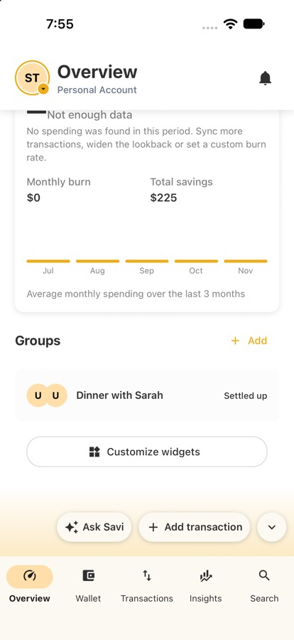
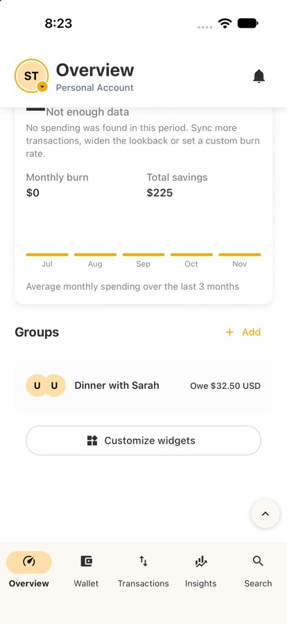
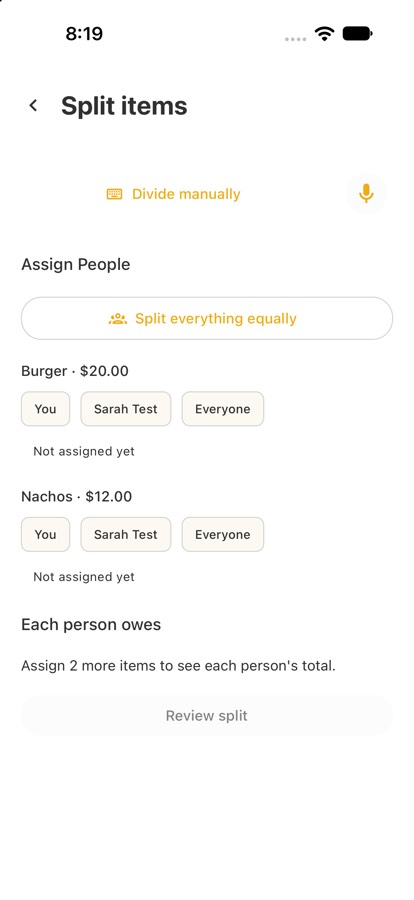
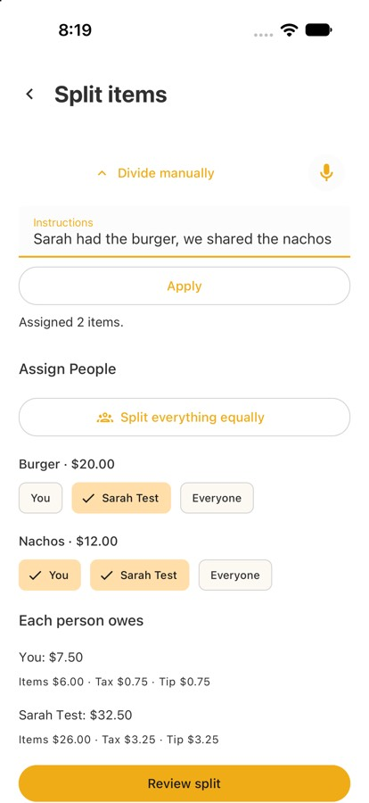
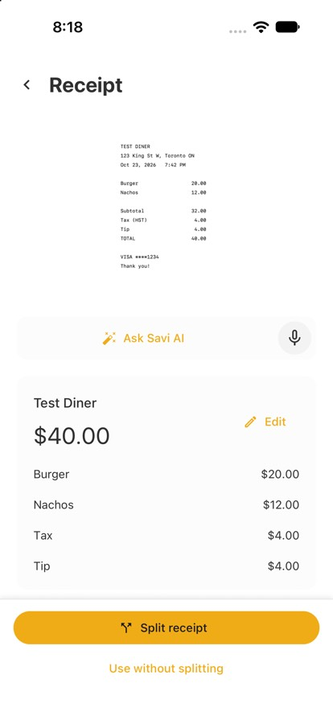
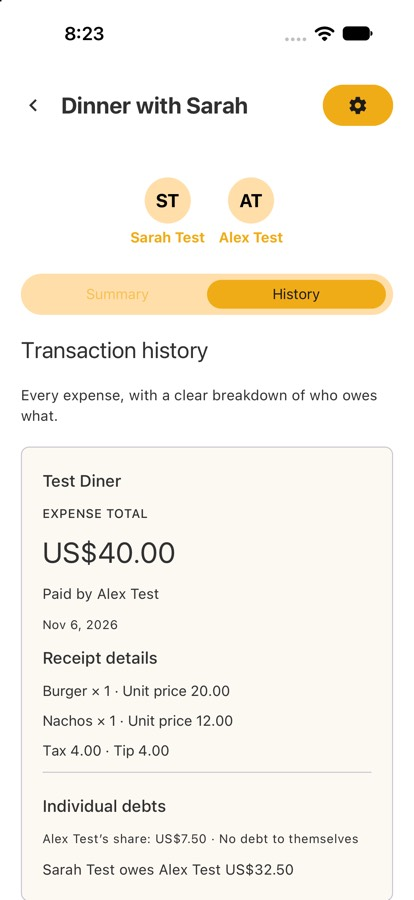

# Savi Finance — Group Split with Voice

> Development progress. Feature availability depends on the supplied app build and backend; development demos are not a production release.

## Project

We are extending Savi Finance so people can split shared expenses, understand their own spending, and review who owes whom without maintaining a separate spreadsheet. Our team's work covers one-off splits, receipt/item splitting with voice or typed assignment, group transaction splits, and a balances overview.

**Implementation repository:** [Savi Finance's private monorepo](https://github.com/cheapreats/ce). Teaching staff need access to this repository to inspect the linked implementation PRs and evidence. The features described below are our team's contributions, not a description of the entire Savi product.

**A note on deployability:** We know that a component of the deliverables (such as D2 currently) is having a deployable version of the application for public access. Since we're working on a feature for Savi, an app with an existing userbase, this isn't always possible. We have our features for user stories mostly completed, but the process of merging them into the real codebase will take a little more time/coordination with the Savi team. In order to account for this, we have linked the branches/PRs that we worked on, with screenshots and demo videos attached to showcase our work. We discussed this approach with our tutorial TA, Rayan, who approved of this approach. Thanks!

## D3 Improvement and Walkthrough Video

**What changed since D2:** After D2, a receipt split could be built but not saved, so it never became a real group expense. In D3, receipt splitting saves through the shared group-expense flow: one person scans a receipt, assigns items to group members (by tapping, or by typing a sentence), and saves it; the other person then sees what they owe on their own account and in the group's history.

**Walkthrough video (3:30):** [Receipt split, end to end](https://drive.google.com/file/d/1_RcoIVwYVeFO3oh8SeUBXMU0YUKbhP6R/view?usp=sharing). Recorded on the iOS Simulator against a local Savi backend running the integration branch ([#6761](https://github.com/cheapreats/ce/pull/6761)), with two test accounts. Alex scans a receipt (Burger $20, Nachos $12, tax $4, tip $4), assigns items by typing *"Sarah had the burger, we shared the nachos"*, and saves; Sarah then sees that she owes $32.50. The scan step waits about 15 seconds for the AI response.

| Before | After |
|---|---|
|  |  |
|  |  |
|  |  |

## Key Use Cases

### Splitting a one-off expense (David, Shaun)

**Why:** split a shared purchase without creating a group, and track your own spending separately from the full payment.

**What it does:**

- Splits a personal expense with existing Savi users or saved guests using equal, amount, or percentage allocations.
- Validates that shares add up correctly and handles leftover cents consistently.
- Saves the split with the transaction; **Manage split** lets you edit or remove it later.
- Counts your share in Spending and budget alerts while Wallet keeps the full payment: a $120 expense split equally between two people contributes $60 to your spending.

**How to try it** (signed in to the configured development build, with split saving enabled):

1. Tap **Add transaction → Expense**, enter the name, amount and date, and choose an account owned by your personal profile.
2. Tap **Split → Total with Others → Add people** and select at least one saved person.
3. Choose **Equal**, **Amount**, or **Percentage** and check the allocation.
4. Tap **Apply split**, then **Create** to save. Applying alone only updates the draft.
5. Reopen through **Edit → Manage split** to change or remove it, then save. Compare **Wallet** with **Insights → Spending** to see the full payment versus your share.

**Development limits:** PR6 is a read-only preview; saving requires PR7 and own-share spending requires PR8. PR7/8 remain development-only drafts with one unresolved integration-test failure. Guest creation, invitations, settlement, and money transfers are not included. Verification details and known simulator limitations are in the linked PRs.

**Screenshots, video and implementation:** [PR6: editor preview](https://github.com/cheapreats/ce/pull/6624), [PR7: saving and Manage split](https://github.com/cheapreats/ce/pull/6768), [PR8: own-share spending](https://github.com/cheapreats/ce/pull/6769) (Savi's private repository).

### Splitting a receipt by item (Praneeth, Shahmeer)

**Why:** After a group purchase, people buy different things and may want a more nuanced way of splitting. With this change, Savi users can split a receipt line by line inside the app, by either taking a photo or manually entering items, instead of using a spreadsheet or more complex solution.

**What it does:**

- Starts from the existing **Add transaction → Split → Line Items** flow, as requested by our partner.
- Extracts merchant, total and item information from a receipt photo using Savi's existing AI service, or lets you enter the receipt manually. You can correct items, quantities and discounts, and enter tax and tip.
- You choose which group members shared the meal, then tap who had each item, or say or type it: *"Sam had the burger, Alex and I shared the nachos."*
- Shared items are split evenly; tax and tip are split by what each person ordered; amounts always add up exactly to the receipt.
- A review screen shows your share and what each person owes you. On the integration branch, Create/Save records the payment, receipt details and group debts.
- Group invitations can now be accepted from the Notifications screen, so friends can join a group before splitting.

**How to try it** (signed in to the development app, with Groups enabled; use the integration branch and local backend for saving):

1. Enable `group_card` under **Diagnostics → Feature Flags** if Groups is hidden. Create a group from **Overview → Groups**, then open the group's settings (gear icon) → **Invite member** and enter your friend's email; they accept from **Notifications → Join**. (Leave the email field on the Create a Group screen empty: invites entered there do not reach the friend's Notifications yet.)
2. Tap **Add transaction**, choose **Expense**, enter the name and amount, and select a test account owned by the payer. Tap **Split → Line Items → Split receipt items with people**.
3. Choose the group, then take or upload a photo of the receipt, or type the items, tax and tip.
4. Tap **Choose people**, then **Assign items**: tap names on each item, or type a sentence like the one above and tap **Apply**.
5. Tap **Review split**, then **Use split in transaction** to return to the transaction draft. This step alone does not save an expense.
6. Tap **Create** (or **Save** for an existing expense), then open the group's **History** and **Summary** to see the saved receipt and balances.

Live extraction uses `openai/gpt-6-luna` through OpenRouter, pinned to `azure/us`. A generated receipt was successfully read through the authenticated local API ($35 total, with a $28 soup line). Photo-library upload and live extraction were verified in the iOS simulator using a generated receipt. Real-photo accuracy, camera capture and real-device microphone behavior still need verification. Typed assignment and manual receipt entry are available without live AI inference. Saved receipt item/assignment editing, group budget-share adjustments and post-save notifications remain unfinished.

**Demo video and screenshots:** [D3 walkthrough video](https://drive.google.com/file/d/1_RcoIVwYVeFO3oh8SeUBXMU0YUKbhP6R/view?usp=sharing) on the integration branch ([#6761](https://github.com/cheapreats/ce/pull/6761)); earlier D2 demo on [Savi pull request #6759](https://github.com/cheapreats/ce/pull/6759) (Savi's private repository).

### Splitting a transaction with a group (Sumedh, Pranay)

**Why:** when one person pays for a shared expense, the app has to remember who owes what, or the split disappears as soon as the screen closes. Saving each person's share on the server is what lets Savi show balances and history, and keeps two people (or two devices) from overwriting each other's edits.

**What it does:**

* Creating a group expense saves a debt record for each non-payer participant with a positive amount owed. The payer's own share is what is left of the total (a $12 expense shared by the payer and one member saves a single $6 debt, and no debt to oneself), and shares can add up to less than the total but never more.
* Sending the same create request twice, such as a retry after an uncertain submission, returns the existing expense instead of creating a duplicate.
* The caller must have an editing role in the group, and each participant must be an accepted member. Only the payer needs a funding account; if another participant's account is supplied, its ownership is checked.
* Deleting an expense also deletes its shares, and editing the total can't go below what is already assigned to people.
* Getting or listing group expenses returns who owes what, which is what the History and Summary screens read.
* Each expense has a version number. An edit or delete can send the version it last saw, and if someone changed the expense in the meantime, it is refused with "changed by someone else" and nothing is overwritten.

**How to try it** (signed in to the development app, with Groups enabled and a backend that includes the saved-shares work):

1. Create a group from the Groups section and invite a friend. They accept it from the bell icon (Notifications → Join). Only the payer needs a funding account; the friend can participate without linking a bank account.
2. Open the group and tap New Transaction.
3. Enter the description and amount, pick the account that paid, and choose the members who shared the expense.
4. Choose how to split it (even, by amount, or by percentage) and check the preview of who owes what.
5. Save the transaction. Open the group's History and Summary to see the expense, who paid, and the amount each person owes. These are saved on the server, so they are still there after you close and reopen the app.

In progress: repayment and settling up, attaching an existing transaction to a split, app screens for editing and deleting a group expense (the backend already supports both), and connecting the app to the edit-conflict check.

**Demo video and screenshots:** [Savi pull request #6760](https://github.com/cheapreats/ce/pull/6760) (Savi's private repository).

### Group split integration (Praneeth, Shahmeer, Sumedh, Pranay)

The four-person group split team combines the receipt and transaction-splitting pairs' work on **`feature/integrate-receipt-split`**, connecting and verifying the shared save flow. The original branches, commits and authors are preserved.

**What was integrated and how it works:**

- Both flows use the same group members, shared expense storage, debt records and History/Summary screens. Transaction splitting produces shares from a total; receipt splitting produces shares from item assignments and proportional tax/tip.
- Receipt review passes the confirmed allocation back to Create/Edit Transaction. Create/Save then calls the shared group-saving API, creates or links one full personal payment, and records debts for the other participants. Receipt items, quantities, discounts and assignments are retained with the group expense.
- Repeating an unchanged receipt save returns the same payment and expense instead of creating duplicates or resetting partial repayments. Interrupted receipt saves can be resumed from group History.
- The verified local example is a $35 receipt split between two people: one $35 personal payment, a $17.50 payer share and a $17.50 debt shown in group History/Summary. This records obligations; it does not transfer money.

**Integration PR and verification:** [Savi PR #6761](https://github.com/cheapreats/ce/pull/6761). This branch holds our overall development progress on the two group split flows as a checkpoint for D2. We plan to organize the changes into a **stack of smaller PRs** so the Savi team can review them more easily.

### Owes / Owed Widget (Sambhav)

**Why:** Savi users can see where they stand on the home screen, without checking each group or transaction.

**What it does:**

- Adds a **Splits** card to the Overview with two totals: **Owed to you** and **You owe**.
- Combines one-off splits from your own transactions with group splits.
- Tap a total to see the breakdown **by person** and **by group**; group balances name the person you owe.
- Mark a person's balance as **resolved** once you've settled up, and **undo** it if you made a mistake.
- Resolved balances drop out of the totals but stay in a **Resolved** history list.

**How to try it** (signed in to the Savi app):

1. Turn on the card: **Account → Diagnostics → View All Flags**, then switch on `mobile_split_balances`.
2. Go to **Overview** and scroll to the **Splits** card.
3. Tap **Owed to you** or **You owe** to see the breakdown by person and by group.
4. Tap **Resolve** next to a person: the total drops and they move to **Resolved**.
5. Tap **Undo** in the Resolved list to bring the balance back.

**Screenshots:** [Savi pull request #6770](https://github.com/cheapreats/ce/pull/6770)

## Deliverable 2

- [Iteration review and retrospective](deliverables/D2/iteration-02-review.md)
- [Individual contributions](deliverables/D2/Individual_Contributions_Deliverable2.md)
- Group split integration checkpoint: [`3f5caef7b`](https://github.com/cheapreats/ce/commit/3f5caef7b2d047ecd64b25c4c9849c700fd67c10), linked through [integration PR #6761](https://github.com/cheapreats/ce/pull/6761). The other feature PRs provide their own implementation and verification details.

## Deliverable 1

- [Planning document](deliverables/D1/planning.md)
- [Mockup instructions](deliverables/D1/mockup.md)
- Team information: `deliverables/team/`

## Confirmed Course and Meeting Context

- Official CSC301 group number: **15**. Team name in the tutorial schedule: **Team 12**.
- Deliverable 1 is due **Friday, October 2, 2026 at 11:59pm Toronto time**. [Quercus assignment](https://q.utoronto.ca/courses/441425/assignments/1794225).
- Tutorial: **Thursdays, 7:00-7:30pm Toronto time**, with mentor TA **Rayan El Ghazzi**. D1 Demo Day is **Thursday, October 1, 2026**. [Tutorial schedule](https://q.utoronto.ca/courses/441425/pages/tutorial-schedule).
- Recurring partner meeting: **Wednesdays, 6:00-6:20pm Toronto time**, on [Google Meet](https://meet.google.com/ogv-qkay-sxa), organized by **ralphpalxyz@gmail.com**.
- Mentor TA contact: **rayan.el.ghazzi@mail.utoronto.ca**. [Course syllabus](https://q.utoronto.ca/courses/441425/assignments/syllabus).

## Task Management

The team uses **Jira for ticketing and task distribution and Slack for asynchronous communication**, through Savi Finance's internal platforms.

## Access and Use

This course repository contains the project documentation; the implementation lives in Savi's private monorepo. Teaching staff need repository access to open the linked PRs and demo evidence. Each feature section describes the relevant development workflow and limitations. The group split integration runs locally using the setup below; these unmerged changes are not available merely by installing Savi's released app. Historical D1 prototype information is in the [mockup instructions](deliverables/D1/mockup.md).

## Development Requirements

This course repo is not a standalone application. For all who wish to set this repo up locally, they must follow **Savi Finance's existing setup instructions**.

- [Savi local backend setup](https://github.com/cheapreats/ce/blob/feature/integrate-receipt-split/dev/README.md)
- [Savi mobile development setup](https://github.com/cheapreats/ce/blob/feature/integrate-receipt-split/sba-mobile/README.md)
- [Receipt split setup, behavior and limitations](https://github.com/cheapreats/ce/blob/feature/integrate-receipt-split/sba-mobile/screens/groups/RECEIPT_SPLIT_HANDOFF.md)

Developers need access to the private monorepo, Node.js/npm, Go/Bazel and Docker for local services. The mobile app uses an Expo development build; iOS requires macOS/Xcode and Android requires the Android development tools. Expo Go does not include all of Savi's native modules.

For the two group split flows:

1. Check out `feature/integrate-receipt-split` in Savi's monorepo. Run both the mobile app and backend from this branch.
2. Follow the backend guide and start `make dev-up` from the monorepo root in a dedicated terminal.
3. Follow the mobile guide to build/install a development client, configure the simulator's local HTTPS trust, and run `make dev-mobile`. In `sba-mobile/`, install dependencies with `npm ci` and start Metro with `npx expo start --dev-client --clear`.
4. Sign in with an approved development/test account and use the feature steps above. Enable `group_card` if Groups is hidden. Create a test group and a payer-owned test account as needed; the prepared demo group on one developer's laptop is not automatically present on another machine.

For **live receipt extraction**, set these in the backend's ignored `sf1/api/.env`, then restart the backend:

```dotenv
OPEN_ROUTER_API_KEY=<approved development key>
OPEN_ROUTER_FAKE_MODE=
```

The model (`openai/gpt-6-luna`) and provider (`azure/us`) are configured in code. The mobile client must point to the local backend; a local key does not change Savi's hosted API. Manual receipt entry, assignment and saving do not require an OpenRouter key. Use fake-provider mode for the hermetic test suite, as described in Savi's setup documentation.

## External Dependencies

Our split workflows extend Savi's existing application stack and APIs. Local manual-expense demos do not require live banking connections.

### Application and Framework Dependencies

- **React Native** — used to build the Savi mobile application.
- **Expo / EAS** — used for local mobile development and mobile builds/deployment.
- **Go + Bazel** — used for Savi's backend services and build system.
- **MongoDB** — Savi's primary database.

### Internal APIs and Services

- **`sf1/api`** — Savi's main backend API, which the mobile application uses to communicate with backend functionality.
- **Existing transaction and receipt services** — reused for personal payment creation/editing, receipt extraction and attachment handling.
- **On-device voice/typed assignment parser** — maps spoken or typed item assignments to receipt participants. Voice follow-ups and model-based assignment fallback remain separate work.

### Third-Party Services and APIs

- **Plaid** — Savi's existing banking data provider and may be relevant for transaction-based splitting.
- **OpenRouter / OpenAI on Azure** — receipt image extraction uses `openai/gpt-6-luna` through OpenRouter's `azure/us` route. Manual receipt entry remains available without this service.
- **AWS S3 / local MinIO** — Savi's attachment storage and its local development equivalent.
- **GitHub Actions** — used as part of Savi's CI/CD process.

Live service credentials and environment configuration follow Savi's setup instructions and remain outside this course repository.

## GitHub Workflow

Implementation work stays on feature branches in Savi's monorepo and is submitted through PRs following the company's review and merge practices. The receipt and group transaction branches remain available as individual contribution evidence; the integration branch combines their work for testing and demonstration. Savi controls review and merging into its production codebase. Course documentation is maintained separately in this repository through team branches and PRs.

## Development Process and Infrastructure (D3)

Since we are adding features to Savi's existing app, we use the company's development and testing setup. Our work includes adding tests for our split features, checking that the two group split flows work together, and testing the app in the simulator. The links below point to the implementation repository, which teaching staff have been given access to.

### CI/CD Pipeline

When we open or update a pull request, GitHub Actions runs checks on the affected parts of the app. For the mobile app, these include TypeScript checks for type errors, ESLint for code issues, and Jest for automated tests. For the server, Bazel builds the changed code and runs the relevant Go tests. Other checks look for formatting problems, accidentally committed secrets and security issues.

The [Required Checks workflow](https://github.com/cheapreats/ce/blob/feature/integrate-receipt-split/.github/workflows/required-checks.yaml) chooses which checks to run, and the [CI PR workflow](https://github.com/cheapreats/ce/blob/feature/integrate-receipt-split/.github/workflows/ci_pr.yaml) defines the mobile and server checks. Results can be viewed in the [Actions tab](https://github.com/cheapreats/ce/actions) or directly under [Checks on our integration PR](https://github.com/cheapreats/ce/pull/6761/checks). The [CI Main workflow](https://github.com/cheapreats/ce/blob/feature/integrate-receipt-split/.github/workflows/ci_main.yaml) also runs when relevant changes reach `main`.

Savi controls when changes are merged and released to users. Its [iOS app build](https://github.com/cheapreats/ce/blob/feature/integrate-receipt-split/.github/workflows/expo_build_ios.yaml) and [development app build](https://github.com/cheapreats/ce/blob/feature/integrate-receipt-split/.github/workflows/expo_build_mobile_dev.yaml) are started manually through GitHub Actions. They then use Expo's EAS service to build the app, with build settings in [eas.json](https://github.com/cheapreats/ce/blob/feature/integrate-receipt-split/sba-mobile/eas.json). Our branch therefore does not automatically become a TestFlight release when code is merged.

These workflows run on Savi's own Azure machines. They reuse downloaded dependencies, run checks based on the files changed, and cancel older runs when a PR is updated. Some jobs have 30–60 minute limits, which are longer than the course's suggested five minutes. Savi manages these settings, so we are documenting this setup under the brief's guidance for partner-controlled projects.

### Testing Infrastructure: Tools, examples and commands

We use a few types of tests because checking the split calculations alone would not tell us whether the screens and saving flow work:

- **Unit tests** check individual calculations and validation rules. The mobile app uses [Jest with `jest-expo`](https://github.com/cheapreats/ce/blob/feature/integrate-receipt-split/sba-mobile/package.json), while the server uses Go's built-in `testing` package through Bazel.
- **Screen tests** use React Native Testing Library to simulate actions such as tapping a person's name or entering an assignment. They check the displayed result, updated selections and navigation between screens. An example is [ReceiptSplitAssignmentScreen.spec.tsx](https://github.com/cheapreats/ce/blob/feature/integrate-receipt-split/sba-mobile/screens/groups/ReceiptSplitAssignmentScreen.spec.tsx).
- **API tests** send requests to a local server and check what is saved in the database. Savi calls these [hermetic tests](https://github.com/cheapreats/ce/blob/feature/integrate-receipt-split/smoke-tests/hermetic/README.md). They use Jest, temporary test users and local services started with Docker. External services return test responses, so ordinary tests do not need real banking connections or paid AI calls.
- **Manual tests** let us check the complete app flow in the simulator: upload a receipt, correct its fields, choose people, assign items, review the split and save it. Screenshots and videos are included in our feature PRs. Real-device microphone testing is still needed; feeding a sample transcript into a screen test only checks how the app handles the words it receives.

Some examples of tests we added are:

1. Shared items, tax, tip and leftover cents add up to the receipt total, and tax already included in prices is not added twice ([split calculation tests](https://github.com/cheapreats/ce/blob/feature/integrate-receipt-split/sba-mobile/screens/groups/receiptSplitAllocation.spec.ts)).
2. Invalid prices, quantities and discounts prevent the user from confirming an incorrect split ([receipt validation tests](https://github.com/cheapreats/ce/blob/feature/integrate-receipt-split/sba-mobile/screens/groups/receiptSplitDraft.spec.ts)).
3. An assignment with an unclear name or item asks for correction instead of assigning it to the wrong person ([assignment tests](https://github.com/cheapreats/ce/blob/feature/integrate-receipt-split/sba-mobile/components/groups/voiceAssignment.spec.ts)).
4. Receipt reading keeps the cents in a price and leaves uncertain values for the user to correct ([receipt extraction tests](https://github.com/cheapreats/ce/blob/feature/integrate-receipt-split/sf1/api/rpc/handlers/get_transaction_info_by_receipt/analysis_test.go)).
5. Saving a split creates the correct amounts owed by each person, without creating a debt to the payer themselves ([saved-share tests](https://github.com/cheapreats/ce/blob/feature/integrate-receipt-split/sf1/api/rpc/handlers/create_group_transaction/debt_rows_test.go)).
6. Retrying a receipt save does not create another payment or duplicate what people owe ([save-flow API test](https://github.com/cheapreats/ce/blob/feature/integrate-receipt-split/smoke-tests/hermetic/definitions/createGroupTransaction-rpc.hermetic.ts)).

**To try the tests:** start in Savi's implementation repository, on `feature/integrate-receipt-split`. The following selection can run without starting the server or providing an OpenRouter key:

```sh
cd sba-mobile
npm ci
npm test -- --runInBand --runTestsByPath \
  screens/groups/receiptSplitAllocation.spec.ts \
  screens/groups/receiptSplitDraft.spec.ts \
  components/groups/voiceAssignment.spec.ts
```

We ran this selection on commit [8396ef5da](https://github.com/cheapreats/ce/commit/8396ef5dab647766648fefe924c5974d90615c32), and **all 66 tests across the three files passed**.

To run the server tests, follow Savi's Go/Bazel setup, then run these commands from the implementation repository root:

```sh
cd sf1
bazel test --jobs=2 \
  //api/rpc/handlers/create_group_transaction:create_group_transaction_test \
  //api/rpc/handlers/get_transaction_info_by_receipt:get_transaction_info_by_receipt_test
```

The API tests need the local server and database running. Follow the [backend setup guide](https://github.com/cheapreats/ce/blob/feature/integrate-receipt-split/dev/README.md), check the services with `make dev-status`, and set `OPEN_ROUTER_FAKE_MODE=hermetic` in the backend environment before restarting it. Then run:

```sh
cd smoke-tests/hermetic
npm ci
npm run test:hermetic:filter -- 'createGroupTransaction|getTransactionInfoByReceipt|uploadFile'
```

Savi also provides `make presubmit`, run from the implementation repository root, for its broader set of checks. Our PRs and [handoff document](https://github.com/cheapreats/ce/blob/feature/integrate-receipt-split/sba-mobile/screens/groups/RECEIPT_SPLIT_HANDOFF.md) record test results and any checks that are still failing.

### Pull requests and code review

We work on feature branches and use pull requests to explain our changes and request review. The main links for the two group split flows are [receipt splitting #6759](https://github.com/cheapreats/ce/pull/6759), [group transaction splitting #6760](https://github.com/cheapreats/ce/pull/6760) and [integration #6761](https://github.com/cheapreats/ce/pull/6761). These pages show the code, descriptions, check results and any review comments or approvals. Savi decides when the implementation is ready to merge.

### Environment setup and secrets

Savi provides configuration templates for the [mobile app](https://github.com/cheapreats/ce/blob/feature/integrate-receipt-split/sba-mobile/.env.example) and [server](https://github.com/cheapreats/ce/blob/feature/integrate-receipt-split/sf1/api/.env.example). These show the settings needed to run the project without including real keys. The [Docker Compose file](https://github.com/cheapreats/ce/blob/feature/integrate-receipt-split/dev/docker-compose.yml) starts local versions of services such as the database and receipt storage. The setup steps are linked under [Development Requirements](#development-requirements).

We keep development keys in local environment files that Git ignores. The OpenRouter key stays on the server, since settings prefixed with `EXPO_PUBLIC_*` are included in the app and are visible to users. Savi's build workflows read release credentials from GitHub Actions secrets, including the Expo token used to build the app.

## Non-Functional Requirements (D3)

For receipt splitting, we made focused accessibility and secure-data improvements:

- **Labels and selection states:** Receipt fields and icon-only actions have descriptive accessibility labels. Each item-selection chip identifies both the item and person, such as "Burger: Sam", and exposes whether it is selected. **Assign People** is marked as a heading. A screen test checks that the selection state changes after a tap ([assignment screen test](https://github.com/cheapreats/ce/blob/feature/integrate-receipt-split/sba-mobile/screens/groups/ReceiptSplitAssignmentScreen.spec.tsx)).
- **Understandable errors:** Invalid receipt totals, tax and tip produce specific messages. For example, entering `-1` for tax shows "Enter a non-negative amount with up to two decimal places." We also expose the error as an accessibility hint on the field and remove it when corrected. Validation errors and unmatched typed/voice assignments are marked as accessibility alerts, with polite live updates configured for Android ([receipt editor](https://github.com/cheapreats/ce/blob/feature/integrate-receipt-split/sba-mobile/screens/groups/ReceiptSplitEditor.tsx), [assignment panel](https://github.com/cheapreats/ce/blob/feature/integrate-receipt-split/sba-mobile/components/groups/VoiceAssignmentPanel.tsx)).
- **Secure data handling:** Our feature reuses Savi's existing native session storage / Expo SecureStore and device-bound keychain settings. The OpenRouter credential remains on the backend, and the attachment viewer requires HTTPS. Local receipt viewing uses a development HTTPS proxy rather than allowing insecure preview URLs ([keychain configuration](https://github.com/cheapreats/ce/blob/feature/integrate-receipt-split/sba-mobile/shared/utils/keychainOptions.ts), [attachment viewer](https://github.com/cheapreats/ce/blob/feature/integrate-receipt-split/sba-mobile/components/transactions/attachments/TransactionAttachmentPreview.tsx)). We reused these security foundations; we did not build a separate authentication system.

**Focused evidence (November 4): 43 tests across four suites passed**, covering accessible selection state, receipt-field errors and correction, existing keychain configuration, and refreshing stale/insecure attachment links. The implementation repository's `make secret-scan` also completed with no findings. Run this selection from `sba-mobile/` in the implementation repository:

```sh
node --max-old-space-size=2048 node_modules/jest/bin/jest.js --runInBand \
  screens/groups/ReceiptSplitAssignmentScreen.spec.tsx \
  screens/groups/CreateReceiptSplitScreen.spec.tsx \
  shared/utils/keychainOptions.spec.ts \
  shared/utils/files/displayUtils.spec.ts
```

**Quick demonstration:** In the receipt editor, enter a negative tax and then correct it to show the specific error appearing and clearing. On **Split items**, select a person to show the labelled controls and selected state.

**Limits:** These are code-level and automated-test examples of NFR effort. We have not completed VoiceOver/TalkBack navigation or a large-text layout pass, so we do not claim full screen-reader or dynamic-text compliance. Further details and broader verification limits are in the [NFR handoff notes](https://github.com/cheapreats/ce/blob/feature/integrate-receipt-split/sba-mobile/screens/groups/RECEIPT_SPLIT_HANDOFF.md#nfr-examples-for-receipt-splitting).

## Coding Standards and Verification

We follow Savi's existing component, API, validation and formatting conventions. Changes include relevant mobile/backend regression tests, local demo verification and the monorepo's `make presubmit` checks; verification details and outstanding failures are documented in the implementation PRs.

## License

Our contributions will follow Savi Finance's existing licensing and confidentiality requirements, since we are developing directly within their privately-owned codebase. We will not apply a separate open-source license unless the partner requests.

The code is intended for use within Savi's product and will not be publicly redistributed without permission.
