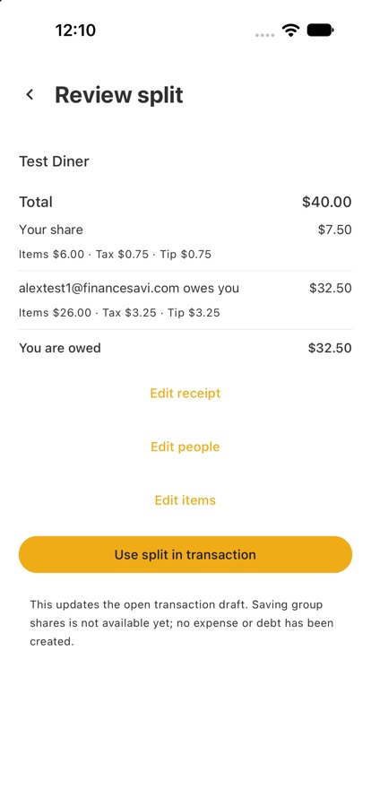
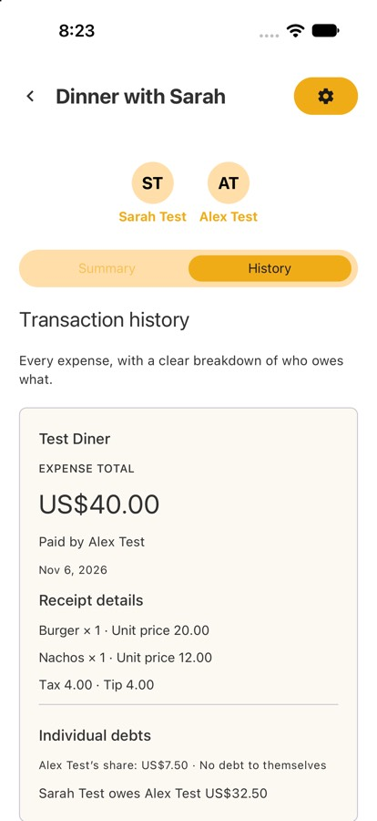

# YOUR PRODUCT/TEAM NAME

> Aim for 1000-2000 words. Be concise and analytical. We care about reasoning, impact, and integration quality, not length.

## 1. What Needed to Improve

After D2, our features worked mostly in isolation rather than as one product. Each sub-team had built its flow on its own branch: receipt splits could be built and reviewed but not saved, the one-off split editor was a read-only preview whose saving lived in a later PR, and receipt and transaction splitting each needed groups, participants, saved shares and balances. A split that isn't saved never reaches the other person, so the core promise of the product (both people can see who owes whom) did not hold end to end. The most important gap was turning these separate prototypes into a connected, reliable flow: one shared way to save group expenses, reviewed code that Savi could merge, and screens clear enough for real users.

We identified this through partner input and team reflection. In our D2 presentation we flagged the overlap between sub-teams and the risk of building two inconsistent saving flows. In PR review, Savi's engineers requested changes (for example, splitting oversized PRs and hiding split data from default API responses), and Savi's CEO asked for less wordy UI. At our planning meetings we agreed to fix and integrate existing PRs before starting new features, and to review each other's PRs before Savi does.

## 2. What You Did

Describe what was implemented, key architectural or design changes, and integration challenges.

Ideas:
Talk about our code changes, both for group split and one-off split. 
Maybe talk about how we approached things differently

## 3. Before vs. After

**D2 vs. D3: a receipt split now becomes a saved, shared expense.** In D2 the receipt flow ended at a review screen that said, in the app, *"Saving group shares is not available yet; no expense or debt has been created."* In D3 the same flow saves through the shared group-expense path, and the debt appears for the other person.

| D2 (#6759) | D3 (#6761) |
|---|---|
|  Review ends with "no expense or debt has been created"; the other person is shown by email |  The saved expense in Sarah's group history, with receipt items and "Sarah Test owes Alex Test US$32.50" |

We verified the D3 flow end to end with two test accounts on a local Savi backend running the integration branch ([#6761](https://github.com/cheapreats/ce/pull/6761)) and recorded it ([walkthrough video](https://drive.google.com/file/d/1_RcoIVwYVeFO3oh8SeUBXMU0YUKbhP6R/view?usp=sharing)). These screenshots are from that run, before and after Alex saves the split:

| | Before Alex saves | After Alex saves |
|---|---|---|
| Sarah's Overview |  "Settled up" |  "Owe $32.50 USD" |
| Alex assigns items |  Every item "Not assigned yet" |  Items assigned, with each person's total |

- **Workflow:** Alex scans a $40 receipt (Burger $20, Nachos $12, tax $4, tip $4) and Savi's AI fills in the merchant, items, tax and tip. He assigns items with the typed-sentence feature from D2 (*"Sarah had the burger, we shared the nachos"*). Tax and tip are split by what each person ordered, so the shares are $32.50 and $7.50 and add up exactly to $40.00. In D3, tapping **Create** saves this as a group expense instead of stopping at the review screen.
- **Visible to the other person:** The expense appears in the group's history with its receipt items, and on Sarah's own Overview, without Alex sending her anything.
- **Names instead of emails:** the D2 review showed the other person by email; D3 shows their name ("Sarah Test owes you").

**Fewer errors reach the partner.** We reviewed each other's PRs before Savi's review, and the authors fixed every issue we posted:
- the Owed/Owing widget counted expenses whose save hadn't finished, and added different currencies into one total ([#6770](https://github.com/cheapreats/ce/pull/6770));
- guest creation and invitations ignored the `EXPENSE_SPLITS_ENABLED` rollout flag, and the guest collection had no database indexes ([#6605](https://github.com/cheapreats/ce/pull/6605));
- participant names could show raw `u_…` user IDs instead of names (#6770, #6605).

**More checks pass.** On the integration PR, Savi's type check went from 15 new errors to none and its test-coupling gate now passes, after fixing two real bugs (unreadable receipt prices were copied into the form without an amount; a receipt-save test never ran) and adding Go tests for the receipt AI client. One mobile test job still fails on filter-menu tests that broke on Savi's `main` and are fixed there; merging `main` into the PR clears it.

## 4. Reflection

What worked well, what was harder than expected, and how this affects your path to D4.

Ideas:
Add reflection
Looking forward
- getting things merged in (should be very soon)
- starting on voice and other things

